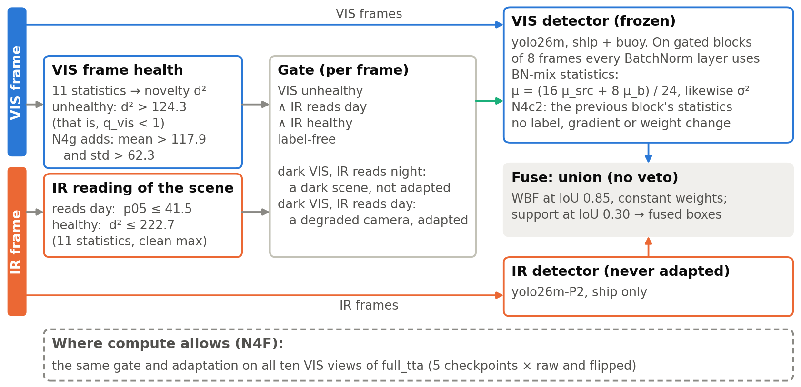
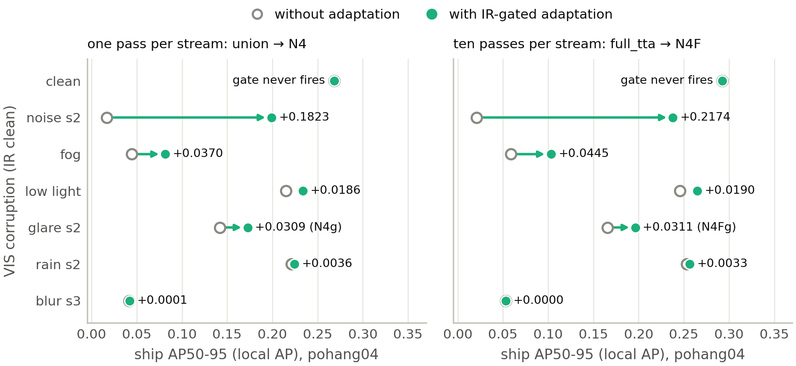
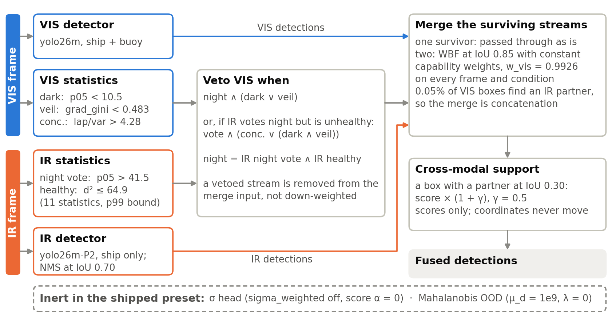
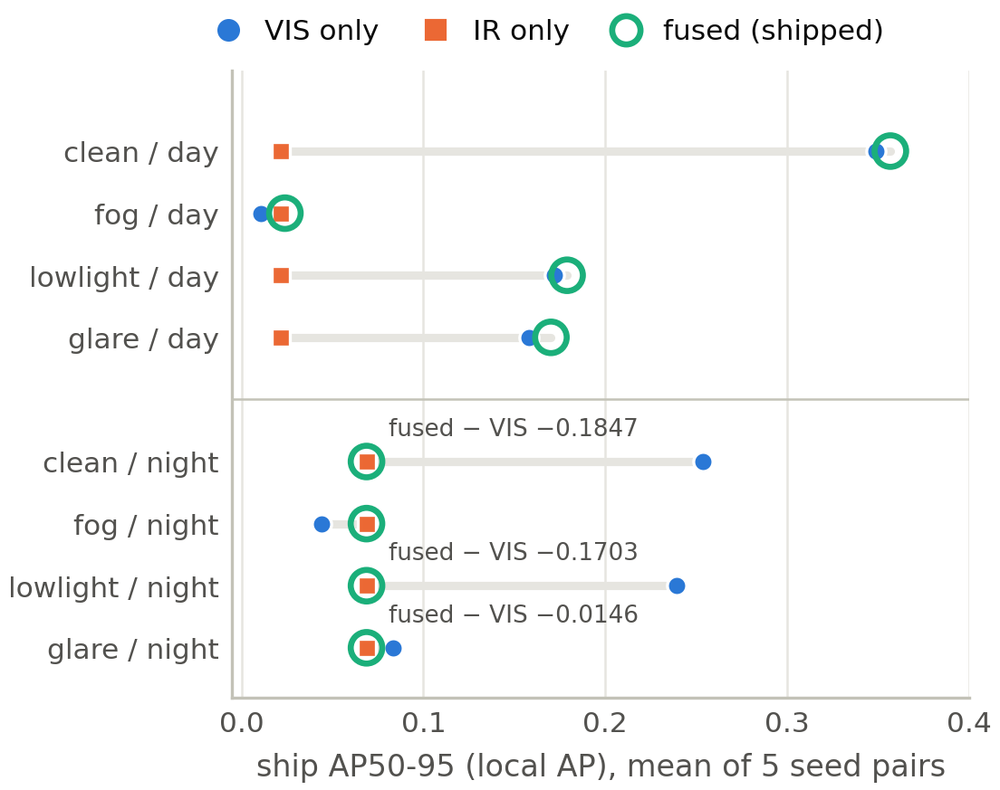
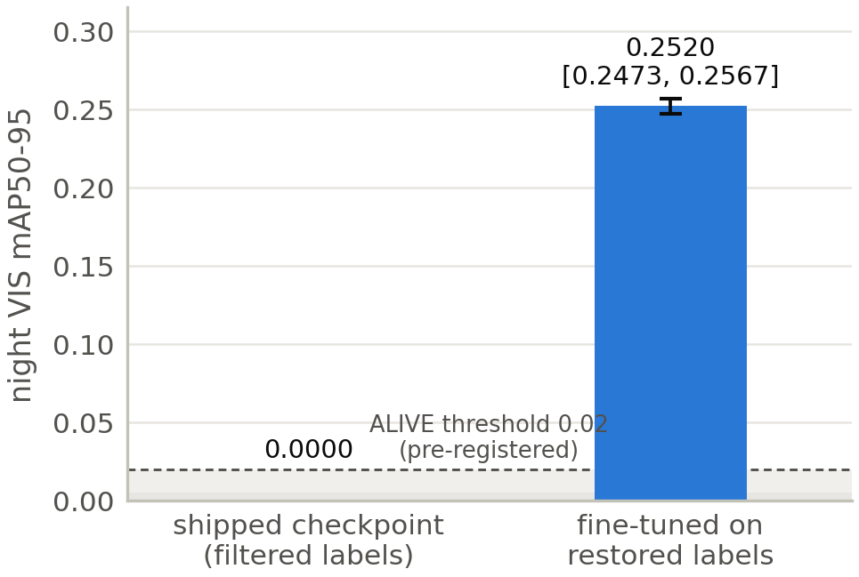
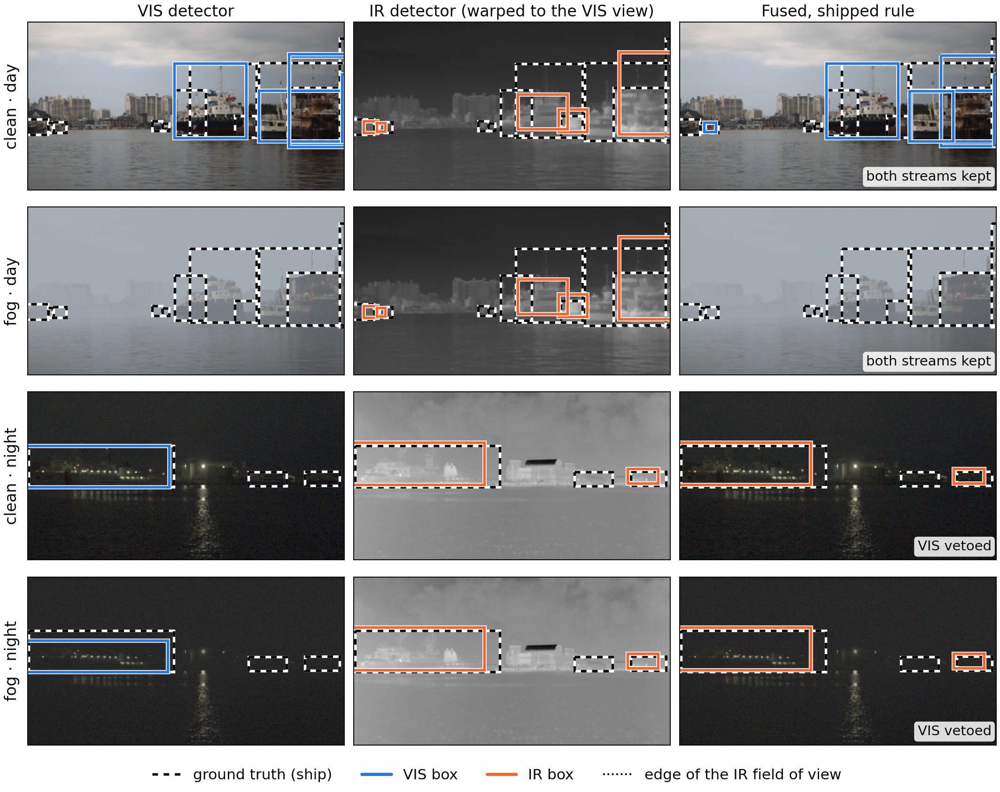
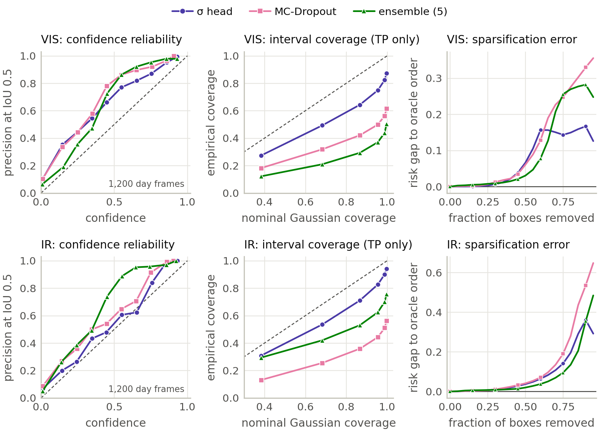
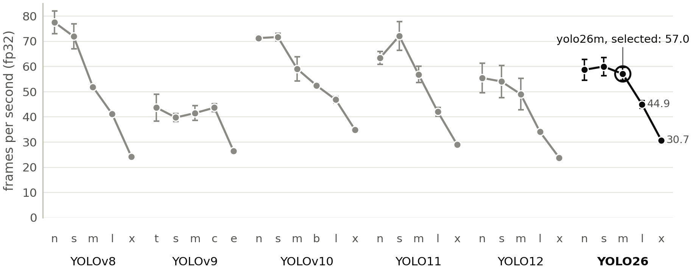

# Let the Thermal Camera Decide When to Adapt: Infrared-Gated Test-Time Adaptation for Visible–Infrared Maritime Detection

**Anonymous authors** (TMLR review is double-blind; restore the author block for the camera-ready).

> The paper. Built to `paper/main.tex` by `paper/build_latex.py`. Every number names its AP convention (local linear-interpolation AP unless stated) and its source file in the record `PAPER_DRAFT2.md`, which carries the full evidence trail; development and held-out results are labelled as such throughout.

---

## Abstract

Visible cameras at sea degrade in fog, low light, glare and sensor noise, and a detector trained on clean frames degrades with them. Re-estimating its normalisation statistics at test time is cheap and needs no label, but adapting frames that were never shifted costs accuracy: on our development benchmark, re-estimation on every frame costs up to 0.031 ship AP at night. The visible camera cannot decide where to adapt, because a dark frame may show a dark scene or a degraded camera; its own health score flags every clean night frame of our development set as unhealthy, and no clean day frame. We let a co-mounted thermal camera decide. Our method re-estimates the visible detector's BatchNorm statistics on eight-frame blocks only where the visible frame reports itself unhealthy and a healthy infrared frame reads daylight. It takes no gradient, changes no weight, never adapts the infrared detector, and has a causal form. On the Pohang Canal dataset with PoLaRIS boxes, every variant was pre-registered before it was scored. It passed development with no cell of 60 worse, and replicated on a held-out run: +0.182 [+0.173, +0.192] ship AP under simulated sensor noise, +0.037 under fog, +0.019 under low light and, with a glare term, +0.031 under glare, with no cell worse. Inside a ten-pass ensemble it adds the same gains, glare included, and the result is the best system we measured on each of the six held-out cells with a corrupted visible stream. We also report what did not work on the same system: predicted box uncertainty is informative but does not improve the fusion, an image-statistic sensor veto cost 0.185 AP at night once the detector was retrained, and no learned gate beat removing the veto. The corruptions are simulated, and the held-out run is a single daylight run, scored nine times under an exposure ledger.

---

## 1. Introduction

Maritime perception systems increasingly pair a visible camera with a long-wave infrared (thermal) camera, on the assumption that the two fail in different conditions. Visible imagery degrades in fog, haze, glare, rain, darkness and sensor noise. Thermal imagery sees through darkness and glare but fails at thermal crossover, when vessel and water reach the same temperature. Neither failure announces itself. A visible detector trained on clean frames meets a fogged or underexposed frame with activation statistics its BatchNorm layers were not fitted to, and simply returns fewer and worse boxes.

Test-time adaptation of normalisation statistics is the cheapest repair available. Replacing or mixing the BatchNorm statistics with those of a test batch (Li et al., 2017; Schneider et al., 2020) needs no label, no gradient and no change to any weight, and it recovers a large part of the loss under common corruptions. Its difficulty is not how to adapt but where. Adapting a frame that was never shifted moves a well-fitted detector away from its training statistics. In our screen, BN-mix applied to every frame gained on corrupted day frames but cost 0.007 ship AP on clean day frames and up to 0.031 on night frames (§5.1). Selective test-time adaptation methods decide where to adapt from the model's own outputs or features: entropy, the divergence of one modality's prediction from the fused one, or feature statistics against a clean reference (§2). A single visible camera faces an ambiguity here that none of these signals resolves. A dark frame may show a dark scene, which the detector was trained on, or a degraded camera, which it was not. The visible detector's own health score cannot tell them apart: on our development set it flags all 1,032 clean night frames as unhealthy and none of the 1,200 clean day frames (§4.1).

A thermal camera answers the question from a different physical process. It measures emitted radiation, so its reading of day and night does not share the visible camera's exposure, scattering or noise. Our method, IR-gated adaptation (registered as N4, the name we keep), re-estimates the visible detector's BatchNorm statistics only where three things hold: the visible frame reports itself unhealthy, the infrared frame reads daylight, and the infrared frame is itself healthy (Figure 1). A dark or veiled visible frame that the thermal camera places in daylight is a degraded camera, not night, and it is adapted. A dark frame the thermal camera places at night is left alone.

We arrived at this design by elimination, on the same two-stream system, and the eliminations shaped it. The system was built so that predicted box uncertainty would weight the fusion of the two streams. A pre-registered test found that uncertainty informative about which boxes are right but not useful for fusing them (§6.1). An image-statistic veto that dropped the visible stream at night shipped instead, and it cost 0.1847 ship AP at night once the visible detector was retrained on corrected labels (§6.2). No learned gate we registered beat switching that veto off (§6.3). Through all of it the thermal camera proved a weak voter on boxes: on our held-out run its stream scores 0.0156 ship AP against 0.2767 for the visible stream. It proved a good judge of the scene.

Our contributions are:

1. **IR-gated test-time adaptation for visible–infrared detection.** A label- and gradient-free adaptation of the visible detector, gated per frame by the thermal camera's reading of illumination and by both streams' frame health (§4). It has a causal form for live streams (N4c2), a glare term (N4g), and composes with a ten-pass ensemble (N4F). To our knowledge it is the first label- and gradient-free test-time adaptation for visible–infrared detection in which the second sensor gates adaptation by judging scene illumination (§2).
2. **Pre-registered evidence, replicated on held-out data.** Every variant was registered before any of its numbers existed. Five passed development on 60 cells with no cell worse, one failed and was dropped, and the five that passed replicated on a held-out run: +0.1823 [+0.1733, +0.1916] ship AP under VIS sensor noise, +0.0370 under fog, +0.0186 under low light and +0.0309 under glare with the glare term, with no cell worse (§5). Every scoring of the held-out run is logged in an exposure ledger.
3. **Negative results that locate where the second sensor helps.** On the same system, predicted uncertainty is informative but not useful for fusion; a sensor-selection veto encodes a claim about the detector and breaks when the detector changes; and frame-level gates pay a score-pooling penalty that a fixed ordering avoids (§6).

Adverse conditions are simulated, from a camera-chain model for fog, low light and glare and from ImageNet-C-style severities for noise, rain and blur. The held-out run is all daylight, and the gate does not fire on its clean frames, so no real degradation has tested the method (§7).

**Figure 1. IR-gated test-time adaptation (N4).** Frame statistics from both cameras gate, per frame and without labels, whether the frozen visible detector normalises with BN-mix statistics re-estimated on a block of eight frames. The visible health score alone flags every clean night frame as unhealthy; the infrared day reading separates a dark scene from a degraded camera, and the infrared health bound keeps a fogged infrared stream from vouching for daylight. The infrared detector is never adapted, and the streams are fused by `union`, the shipped fusion with its veto switched off. Thresholds are the frozen constants the code loads (`runs/eval/structure_constants.json`; the glare term from `scripts/ttbn_variants.py`).

---

## 2. Related work

**Test-time adaptation through normalisation.** AdaBN (Li et al., 2017) replaces BatchNorm statistics with those of the test batch. BN-mix (Schneider et al., 2020) mixes test statistics with the source statistics at a prior strength N; we use it unchanged. TENT (D. Wang et al., 2021) trains the BatchNorm affine parameters by minimising entropy. Adapting where nothing shifted can hurt, and per-sample selection of what to adapt is established: SuMi (Guo and Jin, 2025) adapts only samples that pass feature-quartile and entropy tests, and updates normalisation affine parameters by gradient.

**Multimodal test-time adaptation.** Several methods adapt only the shifted modality, or reweight toward the reliable one. Each decides from the model's own predictions or features, and each updates parameters by gradient. READ (M. Yang et al., 2024) modulates cross-modal attention with a confidence-aware entropy loss. TSA (Chen et al., 2025) learns modality-specific adapters and a router that chooses which modality to adapt, and reports negative transfer when an unshifted modality is adapted, the failure our gate guards against. AdaPGC (Xu et al., 2026) flags the corrupted modality per sample by the divergence of its prediction from the fused prediction. CARAT (Mohapatra et al., 2026) flags each sensor stream against its own clean statistics, and argues that cross-modal agreement misleads when sensors measure different physical processes. DASP (He et al., 2026) flags the biased modality by the redundancy of its fused features. ABPEM (Zhao et al., 2025) bootstraps cross-attention from self-attention under a principal-entropy loss, and MM-TTA (Shin et al., 2022) adapts camera–LiDAR segmentation with cross-modal pseudo-labels. These are evaluated on audio–video classification, sentiment, image–text classification, wearable time series and segmentation. Night-TTA (Liu et al., 2023) adapts night colour–thermal segmentation by training BatchNorm affine parameters against an ensemble teacher, on every night frame.

**Visible–infrared detection with illumination or uncertainty.** UA-CMDet (Sun et al., 2022) weights each object's training loss by a rule built from cross-modal box overlap and RGB illumination, and at inference multiplies the RGB branch's scores by an illumination weight before non-maximum suppression. Zhao et al. (2024) weight the visible and infrared branch losses by a label uncertainty estimated during training. Both use illumination or uncertainty to set fusion weights, not to adapt a detector. Gaussian YOLOv3 (Choi et al., 2019) attaches per-coordinate variance to a single-stage detector; we use its head (§6.1). Maritime YOLO variants such as RDSC-YOLOv4 (Liu et al., 2021) and YOLOv7-Sea (Zhao et al., 2023) report accuracy without uncertainty or adaptation. The Pohang Canal dataset (Chung et al., 2023) with PoLaRIS annotations (Choi et al., 2025) provides paired visible–thermal maritime video with boxes on both streams; the Singapore Maritime Dataset (Prasad et al., 2017) pairs visible with near-infrared video that need not show the same scene, and MassMIND (Nirgudkar et al., 2023) is thermal only.

**What differs here.** We found no test-time adaptation method for visible–infrared object detection; this rests on full-text reads of the eight closest papers (`docs/novelty-ttbn-2026-10-12.md`). Ours differs from the multimodal methods above in three ways. The thermal camera decides *whether* to adapt the visible detector, and it decides from a physical reading of the scene, not from agreement between model outputs. No gradient is taken and no weight changes. And every variant was registered before it was scored, and replicated on held-out data. Selective adaptation itself, adapting only the corrupted modality, is not our contribution, and neither is gating as such.

---

## 3. Setting

### 3.1 Data

The Pohang Canal dataset (Chung et al., 2023) records a 7.5 km route through canal, port and near-coastal water with a visible camera at 2048×1080 and a thermal camera at 640×512, both at 10 Hz. PoLaRIS (Choi et al., 2025) supplies ship and buoy boxes on both streams. There are five runs: pohang00 (day), pohang01 (night), and pohang02 to pohang04 (day). On disk they hold 158,319 images, 1,183,736 boxes and 28,388 paired visible–infrared frames. The two cameras are not co-registered: frames are paired by nearest timestamp, and the residual misalignment, measured, is 3–6 px median per run. Visible frames are letterboxed to 640×640; thermal frames are delivered as 8-bit images by per-frame min–max normalisation. Splits are interleaved contiguous blocks with guard bands, identical across modalities, and the night labels are the corrected set of a registered restore (Appendix A).

### 3.2 Detectors and fusion

Both streams use YOLO26-m (Jocher et al., 2026): the visible detector with two classes, the thermal detector with a single ship class and a P2 neck, because it cannot see buoys. The backbone was chosen on a 93-run benchmark, 31 YOLO variants from six families with three seeds each, trained to a patience of 20 epochs (Table 1; all 31 in Appendix H). The YOLO26 m, l and x variants form a top tier whose differences, at most 0.0040 mAP50-95, are below their seed standard deviations; the best variant of every other family sits at least 0.0142 below the leader. Within the tier, yolo26m is the fastest, at 57.0 frames per second per detector against 30.7 for yolo26x. We use five independently trained system pairs (visible seed k with thermal seed k), trained on the corrected labels with the held-out run removed from every list, and report the mean over the five.

**Table 1. Backbone benchmark: the YOLO26 tier and the best variant of each other family.** Visible detector, 31 variants × 3 seeds trained on the corrected labels to a patience of 20 epochs; seed mean ± sd of the Ultralytics 8.4.90 validation mAP over ship and buoy. This is not local AP, so no value here is comparable with Tables 2 and 3. *Rank* is among the 31 variants. *FPS* is one detector's batch-1 `predict()` at 640 × 640, fp32, GPU clock pinned at 1500 MHz, three seeds (two for yolo12x); two-stream throughput is half, before image statistics and fusion. Seeds whose continuation logs are missing score their 25-epoch best (14 of 93 runs, marked in the full table, Table 18). Sources: `docs/eval/bench_patience20_2026-10-08/table1_ext.md`, `phase1_benchmark/fps.csv`.

| Variant | Family | Rank | mAP50-95 | mAP50 | FPS |
|---|---|---:|---:|---:|---:|
| yolo26x | YOLO26 | 1 | 0.2666 ± 0.0040 | 0.668 ± 0.033 | 30.7 |
| yolo26l | YOLO26 | 2 | 0.2664 ± 0.0070 | 0.677 ± 0.003 | 44.9 |
| **yolo26m** (used) | YOLO26 | 3 | 0.2626 ± 0.0109 | 0.672 ± 0.026 | 57.0 |
| yolov10x | YOLOv10 | 4 | 0.2524 ± 0.0051 | 0.642 ± 0.010 | 34.9 |
| yolo12x | YOLO12 | 5 | 0.2523 ± 0.0091 | 0.641 ± 0.017 | 23.8 |
| yolov8l | YOLOv8 | 8 | 0.2470 ± 0.0033 | 0.634 ± 0.006 | 41.1 |
| yolo11x | YOLO11 | 9 | 0.2466 ± 0.0078 | 0.650 ± 0.022 | 29.0 |
| yolo26n | YOLO26 | 15 | 0.2384 ± 0.0064 | 0.653 ± 0.016 | 58.6 |
| yolov9c | YOLOv9 | 16 | 0.2377 ± 0.0067 | 0.608 ± 0.018 | 43.6 |

The baseline fusion is `union`. Both streams pass to Weighted Boxes Fusion (Solovyev et al., 2021) at IoU 0.85 with constant weights (`w_vis` = 0.9926), and a box whose other-stream partner overlaps it at IoU 0.30 has its score raised by half (cross-modal support). At this threshold only 0.05 percent of visible boxes find a thermal partner, so the fusion is concatenation with a support bonus. The shipped system, `shipped` (preset `crossmodal26m`), is `union` plus a veto that drops the visible stream when the thermal camera votes night and the visible frame reads dark or veiled (Appendix D.2). A registered study of replacements for that veto found that switching it off, `union`, improves on it and that no gate we registered beats `union` (§6.3); `union` is therefore the baseline every adaptation is measured against. `full_tta` is the strongest system that changes no detector: five checkpoints per stream, each run on the raw and the horizontally flipped frame, merged per stream by WBF at IoU 0.55, with non-local-means denoising of thermal frames that fail their health check, and no veto. It costs ten detector passes per stream per frame.

### 3.3 Corruptions

Adverse conditions are simulated on the content rows of each frame. Fog, low light and glare follow a camera-chain model in physical order: atmosphere, optics, sensor noise, exposure, the dataset's own infrared stretch and quantisation. Fog is Koschmieder attenuation in linear radiance on per-frame metric depth (Sakaridis et al., 2018) from Depth Anything V2 (L. Yang et al., 2024). Low light is exposure scaling to the real night level, with the night noise measured on training frames. Glare is a source placed against the frame's computed horizon, with spread and exposure response fitted to the one real sun-entry event in training. Sensor noise, rain and motion blur are ImageNet-C-style severities (Hendrycks and Dietterich, 2019) with no physical anchor. An earlier off-the-shelf corruption set was found broken at the source (its fog was a fixed 21-px blur) and retired; every result in the main body uses the camera-chain set (Appendix B).

### 3.4 Evaluation and statistics

**Development.** 2,232 paired validation frames, 1,200 by day (pohang00, 02, 03) and 1,032 by night (pohang01). The grid crosses five visible conditions (clean, fog at severities 1 and 2, low light, glare) with six thermal conditions (clean, fog at severities 1–3, noise at severities 2–3), by day and by night: 60 cells. Corrupted cells average three corruption draws per system; a cell's value is the mean over the five systems, with a 95 percent t-interval (df 4) on paired deltas.

**Held-out.** pohang04, an all-daylight run of 12,482 frame pairs, was never scored by any fusion system before a single pre-registered look, and none of the five system pairs or their reference statistics saw it. It has no thermal labels, so every held-out number is scored against the visible ground truth (156,652 boxes). Nine cells corrupt one stream at a time with fresh draws (visible fog, low light, sensor noise, rain and blur with clean thermal; clean visible with thermal fog, noise and blur; and clean/clean), and a tenth, visible glare, was added for the glare term. Intervals are paired moving-block bootstraps (block 20 frames, 1,000 replicates), because frames at 10 Hz are autocorrelated and a frame-level bootstrap halves the true width (Appendix C.3).

**Metric and rule.** The metric is ship AP50-95 (local linear-interpolation AP), the only class both detectors emit. One rule decides every registered verdict, on development and held-out data alike: an arm passes (development) or replicates (held-out) if no cell is worse than its baseline by 0.0014 or more with the interval below zero, and at least one cell is better by 0.0060 or more with the interval above zero. The 0.0014 floor is the measured two-sigma noise of a paired delta; 0.0060 is the floor widened by the measured autocorrelation inflation (Appendix C.2–C.3).

**Registration.** Each arm's prediction, cells, statistic and rule were written and committed before any of its numbers existed. The held-out run fits nothing: no constant, threshold or calibration of any system. It is scored only through registered tests, and each scoring is logged in an exposure ledger. It has been scored nine times: the original look of the shipped system, a re-score of its corrupted cells after the corruption model was replaced, and seven later registrations, six of them the adaptation tests of §5.2 (Appendix G).

---

## 4. Method

### 4.1 The ambiguity a single camera cannot resolve

A degraded visible frame raises a question its own pixels cannot answer: is the scene dark, or the camera? The visible health score `q_vis` is the clean-frame bound divided by the Mahalanobis novelty of eleven frame statistics (gradient Gini, the ratio of Laplacian to variance, spectral slope, texture cover and seven others), fitted on clean day frames of the development runs and capped at 1. It is a good detector of an unusual visible frame: it flags fogged, underexposed and noisy day frames. It is also, necessarily, a detector of night. On the development paired set it flags all 1,032 clean night frames as unhealthy and none of the 1,200 clean day frames (`runs/derived/structure/gauss_vis_paired_clean.json`, scored with `runs/eval/structure_constants.json`). Night frames are in the visible detector's training distribution, and adapting them hurts (§5.1). The thermal camera's 5th-percentile reading separates the two cases: clean development day frames lie between 2 and 34 and clean night frames between 49 and 113 on its 8-bit scale.

### 4.2 The gate

Per frame, without labels, the gate fires when three conditions hold:
* the visible frame reports itself unhealthy: `q_vis` < 1;
* the thermal frame reads daylight: its 5th-percentile intensity `ir_p05` ≤ 41.5, the midpoint of the empty margin between clean day and clean night;
* the thermal frame is itself healthy: the Mahalanobis novelty of its own eleven frame statistics is within 222.7, the maximum over clean frames.

The third term exists because a degraded thermal stream can misread the scene: after the dataset's per-frame stretch, thermal fog and noise move a frame's 5th percentile across the day–night threshold (Appendix D.5), and without the health term the gate leaks onto up to 2.2 percent of night frames under thermal fog (`docs/prereg-ttbn-2026-10-11.md`). With it, the gate fires on no night frame under any thermal condition on development.

### 4.3 The adaptation

Frames are taken in non-overlapping blocks of eight consecutive frames. Where the gate fires, every BatchNorm layer of the visible detector normalises with the BN-mix statistics of Schneider et al. (2020):

`μ = (N μ_src + n μ_b) / (N + n)`, `σ² = (N σ²_src + n σ²_b) / (N + n)`,

with N = 16, n = 8, and `μ_b`, `σ²_b` the block's statistics over its frames and spatial positions, computed layer by layer as the block passes through the network. Frames the gate does not pass keep the detector's plain output. No gradient is taken, no weight changes, no label is read, and the thermal detector is never adapted; the two streams are then fused by `union`.

### 4.4 Variants

* **N4c2, causal.** N4 normalises a block with its own statistics, which include up to seven later frames (0.7 s at 10 Hz). N4c2 normalises each block with the statistics N4 measured on the previous block, at the cost of a second pass per block. For a live stream N4c2 is the version to use. A first causal variant, N4c, reused the statistics measured during the previous block's own adapted pass; it failed by construction (§5.1).
* **N4g, glare.** N4's gate almost never fires under glare, because a glared frame is bright and textured and does not look novel to `q_vis`. N4g adds a visible-side term, mean intensity > 117.92 and standard deviation > 62.31, each the maximum over clean development day frames.
* **N4F, inside an ensemble.** The same gate and adaptation applied to every visible view of `full_tta` (ten passes per stream). N4Fg is N4F with N4g's gate.
* **N4ae, restoration on the same gate.** Gated frames that are dark (mean linear luminance below 0.18, auto-exposure's own target) take the detections of an auto-exposed frame instead.

**Where the constants come from.** N = 16 and the gate's terms were chosen on a screen draw before any development verdict; N = 64 halved both the gains and the losses. The visible health bound, the thermal day threshold and the thermal health bound are the frozen constants of the shipped system, fitted on clean development frames. Two choices used the held-out run's label-free frame statistics before any of its scores existed, and we disclose both. The thermal health term was switched from the shipped system's tighter authority bound (its 99th percentile) to the merge bound above after the former was seen to pass only 9.5 percent of clean held-out thermal frames (the latter passes 86.7 percent). The glare thresholds were checked to fire on 0.10 percent of clean held-out frames, after brightness percentiles that separate development glare perfectly were seen to fire on 55 percent of them. No constant was fitted on held-out labels.

---

## 5. Results

### 5.1 Development

**Ungated adaptation hurts.** In a screen on one corruption draw (two systems, not registered), BN-mix with N = 16 on every frame gained +0.0635 and +0.0767 ship AP on low-light day and +0.0088 and +0.0083 on fog by day, and cost 0.0080 and 0.0068 on clean day frames and up to 0.0311 at night (`docs/prereg-ttbn-2026-10-11.md`). The gate is designed to keep the first and remove the second.

**N4 passes development** (Table 2). No cell of the 60 is worse than `union`; the worst Δ is −0.00001. Five are better beyond 0.0060 with intervals above zero: low light by day +0.0706 [+0.0593, +0.0818], low light with thermal fog at severity 1 +0.0357, fog at severity 1 +0.0094, fog +0.0091 and low light with thermal fog at severity 2 +0.0069. The gate fires on 16 cells, all by day: on 100 percent of low-light day frames and 99.6 percent of fogged day frames with clean thermal, and on no night frame under any thermal condition, so N4 equals `union` on every night cell. As thermal fog thickens the gate fires less, because the thermal stream stops vouching for daylight: on low-light day frames it fires on 42.5, 14.9 and 4.5 percent at thermal fog severities 1–3, and on none under thermal noise (`docs/eval/ttbn/ttbn_dev_2026-10-11.md`).

**Table 2. Registered variants on development: 60 cells, five systems, ship AP (local AP), paired against the baseline named.** Better / worse count cells beyond the rule's floors (§3.4). N4F and N4Fg were scored on a second set of draws (VIS 945–947, IR 955–957), a disclosed second and third use; the others on VIS 942–944, IR 952–954. Intervals are 95 percent t-intervals over the five systems (df 4), except N4F's and N4Fg's, whose arms are five-system ensembles and whose intervals are moving-block over frames. N4Fg's rule had no gain requirement: no cell worse than `full_tta`, and none below N4F by 0.0014 where the glare term adds frames. Sources: `docs/eval/ttbn/ttbn_dev_2026-10-11.md`, `ttbn_variants_dev_2026-10-11.md`, `ttbn_causal2_dev_2026-10-11.md`, `ttbn_restore_dev_2026-10-11.md`, `ttbn_fulltta_dev_2026-10-11.md`, `ttbn_fulltta_glare_dev_2026-10-12.md`.

| Variant | Change | Baseline | Better | Worse | Largest gain [95% CI] | Verdict |
|---|---|---|---:|---:|---|---|
| N4 | gate + BN-mix on 8-frame blocks | `union` | 5 | 0 | low light, day: +0.0706 [+0.0593, +0.0818] | PASS |
| N4g | N4 + glare term | `union` | 2 | 0 | glare, day: +0.0240 [+0.0178, +0.0302] | PASS |
| N4c | previous block's statistics, as measured in its adapted pass | `union` | 0 | 10 | low light, day: −0.1637 | FAIL |
| N4c2 | previous block's N4 statistics (causal) | `union` | 4 | 0 | low light, day: +0.0668 [+0.0559, +0.0777] | PASS |
| N4ae | N4 + auto-exposure on dark gated frames | `union` | 5 | 0 | low light, day: +0.0871 [+0.0734, +0.1008] | PASS |
| N4F | N4 on every view of `full_tta` | `full_tta` | 5 | 0 | low light, day: +0.0696 [+0.0620, +0.0757] | PASS |
| N4Fg | N4g's gate on every view of `full_tta` | `full_tta` | 2 | 0 | glare, day: +0.0179 [+0.0141, +0.0207] | PASS |

**The variants.** N4g gains +0.0240 under glare by day and +0.0130 with the thermal stream in light fog; its worst cell is −0.0008. N4c collapses from the first block that uses stale statistics, because they were measured under that block's own stale normalisation rather than N4's: mean maximum confidence falls to 0.21 against N4's 0.75, and it was not taken further. The corrected N4c2 passes; against N4 the price of causality is −0.0038 [−0.0045, −0.0031] on low-light day and within ±0.0003 on fog. N4ae gains +0.0165 [+0.0053, +0.0278] over N4 on low light by day; darkness splits the conditions exactly, since every gated low-light frame is dark and no gated fog frame is, so on fog N4ae is N4. Inside the ensemble, N4F's gain survives almost undiminished (+0.0696 on low-light day, on its own draws), and so does N4g's glare gain (N4Fg, +0.0179 on glare by day). The held-out build runs in half precision with fused batch statistics; a development check priced that at no more than 0.0003.

### 5.2 Held-out replication

Each variant that passed development was registered for the held-out run before any of its held-out numbers existed. All six replicate (Table 3, Figure 2).

**Table 3. The held-out run (pohang04), one corrupted stream per cell: ship AP (local AP) against the visible ground truth, mean over the five systems and the four draws of a corrupted cell.** Δ is paired against the arm's own baseline (`union` for N4 and N4c2, `full_tta` for N4F) with a moving-block 95 percent interval (L = 20, 1,000 replicates). Gate = share of frames the gate passes. The glare row is N4g and N4Fg, whose gate fires on 81.0 percent of glare frames against N4's 1.9 percent (with N4's gate, N4F equals `full_tta` there). Sources: `docs/eval/ttbn/ttbn_p04_2026-10-11.md`, `ttbn_causal2_p04_2026-10-11.md`, `ttbn_fulltta_p04_2026-10-11.md`, `ttbn_glare_p04_2026-10-12.md`, `ttbn_fulltta_glare_p04_2026-10-12.md`.

| VIS condition (IR clean) | Gate | `union` | N4 − `union` | N4c2 − `union` | `full_tta` | N4F − `full_tta` |
|---|---:|---:|---|---:|---:|---|
| sensor noise | 85.2% | 0.0169 | **+0.1823** [+0.1733, +0.1916] | +0.1820 | 0.0206 | **+0.2174** [+0.2079, +0.2265] |
| fog | 67.8% | 0.0445 | **+0.0370** [+0.0328, +0.0408] | +0.0363 | 0.0586 | **+0.0445** [+0.0401, +0.0488] |
| glare (N4g, N4Fg) | 81.0% | 0.1417 | **+0.0309** [+0.0290, +0.0327] | — | 0.1656 | **+0.0311** [+0.0286, +0.0332] |
| low light | 85.2% | 0.2152 | **+0.0186** [+0.0154, +0.0219] | +0.0180 | 0.2458 | **+0.0190** [+0.0152, +0.0232] |
| rain | 18.6% | 0.2209 | +0.0036 [+0.0025, +0.0048] | +0.0035 | 0.2534 | +0.0033 [+0.0022, +0.0047] |
| motion blur | 9.2% | 0.0419 | +0.0001 [+0.0000, +0.0001] | +0.0001 | 0.0530 | +0.0000 [+0.0000, +0.0001] |
| clean (IR clean, blurred, noisy or fogged) | 0.0% | 0.2635–0.2682 | 0 | 0 | 0.2923–0.2936 | 0 |

**N4 (P-T): REPLICATES.** No cell is worse than `union`, and three are better beyond 0.0060 with intervals above zero. Under visible sensor noise, re-estimating the normalisation statistics takes the fused output from 0.0169 to 0.1992; the ten-pass `full_tta` reaches only 0.0206 there. Fog gains +0.0370 and low light +0.0186. On the four cells with a clean visible stream the gate fires on no frame, so N4 is `union` there.

**N4c2 (P-C2): REPLICATES.** The causal version keeps N4's held-out gains, with no cell worse: causality costs at most 0.0007 against N4 (fog), less than the 0.0038 it cost on development low light.

**N4g (P-G): REPLICATES.** None of the nine registered cells corrupts the visible stream with glare, so its registration added a tenth. There N4g gains +0.0309 [+0.0290, +0.0327] over `union` (0.1417 to 0.1726), where N4 alone gains nothing; in the three other cells where the glare term adds two or three gated frames per draw, N4g equals N4 to the fourth decimal.

**N4F (P-FT): REPLICATES.** Inside the ensemble, adaptation adds what it adds alone, with no cell worse than `full_tta`: +0.2174 under noise (0.0206 to 0.2380), +0.0445 under fog (0.0586 to 0.1031), +0.0190 under low light and +0.0033 under rain. Under glare, N4's gate fires on 1.9 percent of frames and N4F equals `full_tta`, so glare was registered separately with N4g's gate (N4Fg, P-FG, after a development pass: +0.0179 on glare by day). It replicates: +0.0311 [+0.0286, +0.0332] over `full_tta` (0.1656 to 0.1967), +0.0240 above one-pass N4g, with no other cell worse than N4F. On each of the six held-out cells with a corrupted visible stream, N4F (N4Fg on glare) is the highest-scoring system we measured.

**N4ae (P-A): REPLICATES, with a cost development could not show.** Low light gains +0.0259 [+0.0231, +0.0285] over `union`, +0.0073 [+0.0046, +0.0099] over N4, as on development. But the held-out rain darkens every gated rain frame below auto-exposure's threshold, so auto-exposure replaces adaptation there and N4ae on rain is 0.0036 below N4. Development has no rain. We do not recommend N4ae for that reason.

**Figure 2. IR-gated test-time adaptation on the held-out run (pohang04), per cell.** Ship AP (local AP) against the visible ground truth, mean over the five systems and, in a corrupted cell, over four corruption draws; the thermal stream is clean in every row. Left, one pass per stream: `union` (hollow) and N4 (filled); the glare row shows N4g. Right, ten passes per stream: `full_tta` and N4F; the glare row shows N4Fg. Labels are the paired Δ; intervals are in Table 3. On the clean cell the gate never fires, so the two markers coincide. Sources as Table 3, with `docs/eval/holdout_p04_gatefree_2026-10-11.json` for the clean baselines; drawn by `scripts/paper_figures.py`.

### 5.3 Where the gate does not fire

The gate's job is as much where it stays off as where it fires. It fires on no frame of the clean held-out cell, on a rounded 0.0 percent of the other clean-visible held-out cells, and on no development night frame under any thermal condition, so on those frames every variant equals its baseline. That matters because the baseline itself is right there. At night, `union` keeps the visible stream that the shipped veto discards. On a night test registered on pohang01's test split, 1,109 frame pairs that no fusion system had scored, `union` beats `shipped` by +0.0273 [+0.0154, +0.0400] and holds fused ≥ max(VIS, IR) at −0.0010 [−0.0049, +0.0031], while `shipped`, which vetoes the visible stream on 90.3 percent of those frames, fails it by 0.0283 (Appendix G.4). The detectors trained on the same run's training split, so this tests the fusion rule, not the detectors, and night AP levels swing from 0.04 to 0.35 between the run's 52-second episodes; directions, not levels, transfer.

### 5.4 An observation, not a test: ranking the adapted streams

N4 inherits a weakness of `union`. Where the visible stream is clean, the fused output falls below the visible stream alone, by 0.0085 to 0.0132 on the held-out run, because the thermal stream's boxes are interleaved with the visible stream's. A fixed ordering that ranks every visible box above every thermal box (`lex`) cannot fall below the visible stream: the scorer matches boxes greedily in score order, so a tail of boxes appended below every existing box cannot lower AP (§6.3). `ttbn_lex`, the same ordering of N4's adapted streams, is above N4 in all nine held-out cells, by +0.0096 to +0.0134 where the visible stream is clean and +0.0008 to +0.0067 where it is corrupted, and it holds fused ≥ max(VIS, IR) in every cell. No verdict was registered for it, and on development `lex` averaged 0.0037 below `union` over the 60 cells. The two data sets disagree, so we report it as a candidate for the next registration and recommend N4 with `union`, as registered.

---

## 6. What did not work on the same system

The adaptation was the last of a sequence of registered attempts to use the second sensor. The earlier ones are what made its design plain, and we summarise them here; the full record is in Appendices D–F.

### 6.1 Predicted uncertainty is informative but does not improve the fusion

Each detector carries a Gaussian variance head (Choi et al., 2019) trained with a beta-weighted negative log-likelihood (Seitzer et al., 2022), and the system was designed so that predicted σ would weight the fusion. We pre-registered the comparison that answers whether it should: real σ against the same σ shuffled onto the wrong boxes, at least three of four conditions above 0.0060 with a block-bootstrap interval excluding zero (Appendix E.2). Used as a weight on box coordinates, σ passes on none of four conditions, and the system's fusion weight was measured to take one value on every frame. Used to re-rank scores, real σ beats shuffled σ on three of four conditions, so it carries information about which boxes are right. But that information is within each detector: by day the gain is the visible detector re-ranking its own boxes, and adding the thermal stream moves it by −0.0040 to +0.0035 with no consistent sign. Against the system with no σ at all the re-ranked system is below on six of eight cells. A shuffled control establishes that a signal exists, not that using it helps. Learned jointly with confidence in a re-ranker of the visible boxes, σ adds +0.0050 [+0.0038, +0.0064] on one checkpoint, and its pre-registered replication on the five retrained detectors failed: positive on all five, beyond the floor on two. Two further lessons came from this test. The recorded runs had scored a ship-and-buoy macro instead of the registered ship AP, and the macro read NULL on the path where ship AP reads a pass; checking that the scored quantity is the registered one belongs in the registration. And on physically modelled corruptions the score-path pass falls to one or two of four.

### 6.2 A sensor veto is a claim about the detector

The system that shipped dropped the visible stream when the thermal camera voted night and the visible frame read dark or veiled (Appendix D.2). Its night arm was written while the visible detector scored 0.0000 at night. That zero turned out to be a label artifact: a filter had deleted every box in dark night frames from the training labels, and a registered restore of the boxes took night visible mAP50-95 from 0.0000 to 0.2520 (Appendix D.4). Retrained on the corrected labels, the visible detector sees at night, and the unchanged rule throws it away: on clean night the fused output equals the thermal stream alone and falls 0.1847 [0.1655, 0.2039] below the visible stream (Appendix D.3). Nothing in the image changed; what changed is the claim the rule makes about the detector. The rule gated on darkness, while what decides whether the visible stream should be dropped is its health, and with the retrained detector those variables no longer coincide. The same confusion appears on the thermal side: under a fogged or noisy thermal stream, the veto's fallback reads a dark low-light day as a fogged night and vetoes a working visible stream on up to 96 percent of day frames (Appendix D.5). The adaptation's gate keeps the two questions apart: it asks the thermal camera whether it is day, and each stream whether it is healthy.

### 6.3 No gate beat removing the gate

Seven learned or hand-written replacements for the veto were registered and scored on fresh corruption draws, from per-stream calibration and Bayesian pair fusion to gradient-boosted trust over 32 backbone features (Appendix F). None beat switching the veto off: `union` is better than `shipped` on 30 of 60 development cells and worse on none, and every gate was worse than `shipped` somewhere by day. Two mechanisms explain most of it. A model of box correctness fitted to a noisy matching target re-orders a detector's own boxes worse than its confidence does. And a frame-level gate pools frames whose scores live on different scales: switching to the visible stream alone on a random three quarters of frames, a choice that carries no information, scores 0.0085 below the interpolation between the two pure policies. What worked used the scorer's structure. Boxes appended below every existing box cannot lower AP, so demoting a stream is never worse than deleting it, and a fixed tier order holds the floor of the better stream by construction (`lex`, §5.4). The largest gain needed no fusion idea at all: ensembling frozen checkpoints helps every arm it is put under, and `full_tta` beats `shipped` on 57 of 60 development cells and on all nine held-out cells (Appendix G.3). The adaptation is the one change in this sequence that acts inside a detector, and it adds to the ensemble rather than competing with it.

---

## 7. Discussion and limitations

**The thermal camera is worth more as a judge than as a voter.** As a second detector, the thermal stream adds little by day on this data: on the held-out run it scores 0.0156 against the visible stream's 0.2767, and fusing it lowers the output wherever the visible stream is clean (§5.4). As a reading of the world it decided the largest gains we measured. Prior selective adaptation decides from the adapted model's own outputs or features (§2). A second sensor that measures a different physical quantity gives a decision that does not share the first sensor's failure: an underexposed visible frame and a night frame look alike to every statistic of the visible frame and differ plainly in the thermal one.

**What we recommend.** For a two-stream detector built from frozen detectors: fuse by `union`, without a night veto; gate BN-mix adaptation of the visible detector on the thermal camera's daylight reading and both streams' health (N4), in its causal form (N4c2) for a live stream; and where ten detector passes per stream are affordable, apply the same adaptation inside an ensemble of frozen checkpoints with flipped views (N4F). Every element was registered before it was scored and replicated on the held-out run. Ranking visible boxes above thermal ones is a candidate, not a recommendation (§5.4).

**Limitations.** The full list is in Appendix I; these bound the claim.
* *Simulated corruptions.* Every gain is on simulated corruptions. The largest, under sensor noise, is on an ImageNet-C-style severity with no physical anchor; fog, low light and glare follow a camera-chain model whose glare constants rest on one real sun event. The gate does not fire on clean held-out frames, so the method has not met a real degradation.
* *One held-out run, all daylight, scored repeatedly.* The held-out run is one daylight run, scored nine times through registered tests. Each later result is a repeated look at the same run, so agreement with development shows replication on one run, not generalisation across runs. Its thermal frames sit far from development's (median health novelty 106.4 against 7.9), which the merge bound tolerates; the night behaviour rests on development and on the pohang01 test split, which shares a run with the detectors' training data.
* *Label-free use of held-out statistics.* Two gate choices used the held-out run's frame statistics, without labels, before its scores existed (§4.4).
* *A healthy thermal stream is required.* Where the thermal stream is degraded the gate fires less, and every held-out adaptation cell has a clean thermal stream. A thermal camera at crossover was not modelled.
* *Development draws were reused.* Five development verdicts share one set of draws, and N4F and N4Fg reused the draws of the gate study; each later verdict is weaker evidence than a first test, as its registration states.
* *Cost.* N4 reads up to 0.7 s ahead; N4c2 removes that at a second pass per gated block. Neither N4 nor N4F was timed. The shipped two-stream pipeline runs at 9.1 FPS end to end on a laptop GPU, bound by its NumPy frame statistics (60.6 ms) rather than its two detectors (38.3 ms), and the gate reads the same statistics.
* *Dataset.* Pohang only, with one night run; the held-out ground truth is visible-only, so a true thermal-only detection counts as a false positive.

**A note on the protocol.** A measured paired noise floor, block-bootstrap intervals and magnitude floors moved 20 of 74 earlier findings of this project to indeterminate when applied retroactively, and a registration exposed a wrong metric in its own recorded runs (§6.1). The adaptation's gains survive these corrections by an order of magnitude: the smallest headline gain, +0.0186, is nearly eight times the 0.0024 maximum of the ship-AP noise floor (Appendix C).

---

## 8. Conclusion

Test-time adaptation of a visible detector is easy to apply and hard to aim: it helps on degraded frames and hurts on clean and night frames, and a visible camera cannot tell a dark scene from a dark sensor. A co-mounted thermal camera can. Gating BatchNorm re-estimation on the thermal camera's reading of daylight and on both streams' health keeps the gains and removes the losses: pre-registered, it passed development with no cell worse and replicated on a held-out run, +0.18 ship AP under sensor noise, +0.037 under fog, +0.031 under glare and +0.019 under low light, causal at a cost of at most 0.0007, and additive to a ten-pass ensemble. The same system's earlier attempts to use the second sensor, as an uncertainty-weighted voter and as a sensor veto, did not survive registration. The second sensor earned its place by judging the scene, not by voting on boxes.

---

## 9. Broader impact statement

The method improves object detection for vessel perception in degraded visibility, a safety application: a missed vessel is a collision risk. Its gains are measured on simulated corruptions and one held-out daylight run, and it should not be deployed on that evidence without testing on real degraded imagery; an adaptation that fires on a frame type it was not validated on could lower detection quality without any visible sign. The method processes only camera frames of public waterways and reads no personal data.

---

## References

Bodla, N., Singh, B., Chellappa, R., and Davis, L. S. (2017). Soft-NMS: improving object detection with one line of code. In *Proceedings of the IEEE International Conference on Computer Vision (ICCV)*, pp. 5562–5570. doi:10.1109/ICCV.2017.593.

Buslaev, A., Iglovikov, V. I., Khvedchenya, E., Parinov, A., Druzhinin, M., and Kalinin, A. A. (2020). Albumentations: fast and flexible image augmentations. *Information*, 11(2), 125. doi:10.3390/info11020125.

Chen, M., Zhang, B., Han, Z., Jiang, W., Wang, Y., Feng, S., Du, Y., and Bao, B. (2025). Test-time selective adaptation for uni-modal distribution shift in multi-modal data. In *Proceedings of the 42nd International Conference on Machine Learning (ICML)*, PMLR 267, pp. 9711–9727.

Chen, Y.-T., Shi, J., Ye, Z., Mertz, C., Ramanan, D., and Kong, S. (2022). Multimodal object detection via probabilistic ensembling. In *Computer Vision – ECCV 2022*, Lecture Notes in Computer Science, pp. 139–158.

Choi, Jiwon, Cho, D., Lee, G., Kim, H., Yang, G., Kim, J., and Cho, Y. (2025). PoLaRIS dataset: a maritime object detection and tracking dataset in Pohang Canal. In *Proceedings of the IEEE International Conference on Robotics and Automation (ICRA)*, pp. 13626–13632. doi:10.1109/ICRA55743.2025.11128583. Preprint arXiv:2412.06192.

Choi, Jiwoong, Chun, D., Kim, H., and Lee, H.-J. (2019). Gaussian YOLOv3: an accurate and fast object detector using localization uncertainty for autonomous driving. In *Proceedings of the IEEE/CVF International Conference on Computer Vision (ICCV)*, pp. 502–511. doi:10.1109/ICCV.2019.00059.

Chung, D., Kim, J., Lee, C., and Kim, J. (2023). Pohang Canal dataset: a multimodal maritime dataset for autonomous navigation in restricted waters. *The International Journal of Robotics Research*, 42(12), 1104–1114. doi:10.1177/02783649231191145.

Geifman, Y., Uziel, G., and El-Yaniv, R. (2019). Bias-reduced uncertainty estimation for deep neural classifiers. In *International Conference on Learning Representations (ICLR)*. arXiv:1805.08206.

Guo, Z., and Jin, T. (2025). Smoothing the shift: towards stable test-time adaptation under complex multimodal noises. In *International Conference on Learning Representations (ICLR)*. arXiv:2503.02616.

He, Y., Guo, Z., and Jin, T. (2026). Decoupling stability and plasticity for multi-modal test-time adaptation. In *Proceedings of the IEEE/CVF Conference on Computer Vision and Pattern Recognition (CVPR)*. arXiv:2603.00574.

Hendrycks, D., and Dietterich, T. (2019). Benchmarking neural network robustness to common corruptions and perturbations. In *International Conference on Learning Representations (ICLR)*. arXiv:1903.12261.

Ilg, E., Çiçek, Ö., Galesso, S., Klein, A., Makansi, O., Hutter, F., and Brox, T. (2018). Uncertainty estimates and multi-hypotheses networks for optical flow. In *Computer Vision – ECCV 2018*, Lecture Notes in Computer Science, pp. 677–693. doi:10.1007/978-3-030-01234-2_40.

Jocher, G., Chaurasia, A., and Qiu, J. (2023). *Ultralytics YOLOv8* (software, version 8.0.0; this work used the Ultralytics library at version 8.4.90). https://github.com/ultralytics/ultralytics. AGPL-3.0.

Jocher, G., and Qiu, J. (2024). *Ultralytics YOLO11* (software, version 11.0.0). https://github.com/ultralytics/ultralytics. AGPL-3.0.

Jocher, G., Qiu, J., Liu, M., Lyu, S., Akyon, F. C., and Kalfaoglu, M. E. (2026). Ultralytics YOLO26: unified real-time end-to-end vision models. arXiv:2606.03748.

Künsch, H. R. (1989). The jackknife and the bootstrap for general stationary observations. *The Annals of Statistics*, 17(3), 1217–1241. doi:10.1214/aos/1176347265.

Küppers, F., Kronenberger, J., Shantia, A., and Haselhoff, A. (2020). Multivariate confidence calibration for object detection. In *Proceedings of the IEEE/CVF Conference on Computer Vision and Pattern Recognition Workshops (CVPRW)*, pp. 1322–1330. doi:10.1109/CVPRW50498.2020.00171.

Ledoit, O., and Wolf, M. (2004). A well-conditioned estimator for large-dimensional covariance matrices. *Journal of Multivariate Analysis*, 88(2), 365–411. doi:10.1016/S0047-259X(03)00096-4.

Lee, K., Lee, K., Lee, H., and Shin, J. (2018). A simple unified framework for detecting out-of-distribution samples and adversarial attacks. In *Advances in Neural Information Processing Systems 31* (NeurIPS 2018).

Li, Y., Wang, N., Shi, J., Liu, J., and Hou, X. (2017). Revisiting batch normalization for practical domain adaptation. In *International Conference on Learning Representations (ICLR) Workshop*. arXiv:1603.04779.

Lin, T.-Y., Maire, M., Belongie, S., Hays, J., Perona, P., Ramanan, D., Dollár, P., and Zitnick, C. L. (2014). Microsoft COCO: common objects in context. In *Computer Vision – ECCV 2014*, Lecture Notes in Computer Science, pp. 740–755. doi:10.1007/978-3-319-10602-1_48.

Liu, T., Pang, B., Zhang, L., Yang, W., and Sun, X. (2021). Sea surface object detection algorithm based on YOLO v4 fused with reverse depthwise separable convolution (RDSC) for USV. *Journal of Marine Science and Engineering*, 9(7), 753. doi:10.3390/jmse9070753.

Liu, Y., Zhang, W., Zhao, G., Zhu, J., Vasilakos, A. V., and Wang, L. (2023). Test-time adaptation for nighttime color-thermal semantic segmentation. arXiv:2307.04470; to appear in *IEEE Transactions on Artificial Intelligence*.

Mohapatra, P., Sui, Y., Yang, H., Lundell, B., Xia, S., and Zhu, Q. (2026). Source-learned reliance for selective test-time adaptation of multimodal time series. arXiv:2610.07499.

Nirgudkar, S., DeFilippo, M., Sacarny, M., Benjamin, M., and Robinette, P. (2023). MassMIND: Massachusetts Maritime INfrared Dataset. *The International Journal of Robotics Research*, 42(1–2), 21–32. doi:10.1177/02783649231153020.

Pang, S., Morris, D., and Radha, H. (2020). CLOCs: Camera-LiDAR object candidates fusion for 3D object detection. In *Proceedings of the 2020 IEEE/RSJ International Conference on Intelligent Robots and Systems (IROS)*, pp. 10386–10393.

Prasad, D. K., Rajan, D., Rachmawati, L., Rajabally, E., and Quek, C. (2017). Video processing from electro-optical sensors for object detection and tracking in a maritime environment: a survey. *IEEE Transactions on Intelligent Transportation Systems*, 18(8), 1993–2016. doi:10.1109/TITS.2016.2634580.

Seitzer, M., Tavakoli, A., Antic, D., and Martius, G. (2022). On the pitfalls of heteroscedastic uncertainty estimation with probabilistic neural networks. In *International Conference on Learning Representations (ICLR)*. arXiv:2203.09168.

Sakaridis, C., Dai, D., and Van Gool, L. (2018). Semantic foggy scene understanding with synthetic data. *International Journal of Computer Vision*, 126(9), 973–992. doi:10.1007/s11263-018-1072-8.

Schneider, S., Rusak, E., Eck, L., Bringmann, O., Brendel, W., and Bethge, M. (2020). Improving robustness against common corruptions by covariate shift adaptation. In *Advances in Neural Information Processing Systems 33* (NeurIPS 2020).

Shin, I., Tsai, Y.-H., Zhuang, B., Schulter, S., Liu, B., Garg, S., Kweon, I. S., and Yoon, K.-J. (2022). MM-TTA: multi-modal test-time adaptation for 3D semantic segmentation. In *Proceedings of the IEEE/CVF Conference on Computer Vision and Pattern Recognition (CVPR)*.

Solovyev, R., Wang, W., and Gabruseva, T. (2021). Weighted boxes fusion: ensembling boxes from different object detection models. *Image and Vision Computing*, 107, 104117. doi:10.1016/j.imavis.2021.104117.

Sun, Y., Cao, B., Zhu, P., and Hu, Q. (2022). Drone-based RGB-infrared cross-modality vehicle detection via uncertainty-aware learning. *IEEE Transactions on Circuits and Systems for Video Technology*, 32(10), 6700–6713. doi:10.1109/TCSVT.2022.3168279. Preprint arXiv:2003.02437.

Tian, Y., Ye, Q., and Doermann, D. (2025). YOLOv12: attention-centric real-time object detectors. In *Advances in Neural Information Processing Systems 38* (NeurIPS 2025). arXiv:2502.12524.

Wang, A., Chen, H., Liu, L., Chen, K., Lin, Z., Han, J., and Ding, G. (2024). YOLOv10: real-time end-to-end object detection. In *Advances in Neural Information Processing Systems 37* (NeurIPS 2024).

Wang, C.-Y., Yeh, I-H., and Liao, H.-Y. M. (2024). YOLOv9: learning what you want to learn using programmable gradient information. In *Computer Vision – ECCV 2024*, Lecture Notes in Computer Science, pp. 1–21. doi:10.1007/978-3-031-72751-1_1.

Wang, D., Shelhamer, E., Liu, S., Olshausen, B., and Darrell, T. (2021). Tent: fully test-time adaptation by entropy minimization. In *International Conference on Learning Representations (ICLR)*. arXiv:2006.10726.

Xu, J., Li, Y., Sun, C., Xu, X., Li, J., and Xu, F. (2026). Multi-modal test-time adaptation via adaptive probabilistic Gaussian calibration. In *Proceedings of the IEEE/CVF Conference on Computer Vision and Pattern Recognition (CVPR)*. arXiv:2604.19093.

Yang, L., Kang, B., Huang, Z., Zhao, Z., Xu, X., Feng, J., and Zhao, H. (2024). Depth Anything V2. In *Advances in Neural Information Processing Systems 37* (NeurIPS 2024). arXiv:2406.09414.

Yang, M., Li, Y., Zhang, C., Hu, P., and Peng, X. (2024). Test-time adaptation against multi-modal reliability bias. In *International Conference on Learning Representations (ICLR)*.

Zhao, H., Zhang, H., and Zhao, Y. (2023). YOLOv7-sea: object detection of maritime UAV images based on improved YOLOv7. In *Proceedings of the IEEE/CVF Winter Conference on Applications of Computer Vision Workshops (WACVW)*, pp. 233–238. doi:10.1109/WACVW58289.2023.00029.

Zhao, J., Wang, Y., Zhang, Y., Wang, H., and Guo, Y. (2024). Uncertainty-aware cross-modality fusion for visible-infrared object detection. In *Proceedings of the International Conference on Digital Image Computing: Techniques and Applications (DICTA)*, pp. 117–125. doi:10.1109/DICTA63115.2024.00029.

Zhao, Y., Luo, J., Luo, X., Huang, J., Yuan, J., Xiao, Z., and Zhang, M. (2025). Attention bootstrapping for multi-modal test-time adaptation. *Proceedings of the AAAI Conference on Artificial Intelligence*, 39(21), 22849–22857. doi:10.1609/aaai.v39i21.34446.

---

## Appendix A. Dataset details

### A.1 Verified counts

All counts below were re-derived from disk on 2026-09-10 and supersede earlier estimates in the project record.

| Quantity | VIS | IR | Total |
|---|---:|---:|---:|
| Images | 127,309 | 31,010 | 158,319 |
| Boxes | 962,960 | 220,776 | 1,183,736 |
| Paired VIS–IR frames | | | 28,388 |

Per-run image counts (VIS / IR): pohang00 21,768 / 10,918; pohang01 24,473 / 11,995; pohang02 27,795 / 6,175; pohang03 27,085 / 1,922; pohang04 26,188 / 0. Paired rows per run: pohang00 10,786; pohang01 11,990; pohang02 3,739; pohang03 1,873; pohang04 0. Pairing is defined by the dataset's own timestamp table, not by frame ordinal: 16,544 of the 28,388 pairs have different VIS and IR indices, with per-run offsets ranging from −155 to +1.

### A.2 Preprocessing

Visible frames are letterboxed, not stretched, from 2048×1080 to 640×338 inside a 640×640 canvas (scale 0.3125, 151 px of pad value 114 top and bottom, area interpolation). Stretching would distort VIS (1.9:1 native) and IR (1.25:1) by different factors and hurt cross-modal overlap. Forty-seven percent of every stored VIS frame is therefore pad, a fact that matters in Appendix A.4. Full-resolution originals are archived and hard-linked in a native-resolution twin used for main-backbone training.

Infrared frames are delivered as 8-bit grayscale by per-frame min–max normalization (each frame's own minimum to 0 and maximum to 255) and letterboxed from 640×512 with 64 px of pad top and bottom. This choice has consequences we disclose: thermal crossover can be visually masked because a near-isothermal vessel is stretched to full local contrast, there is no cross-frame radiometric comparability, and the raw 16-bit data cannot be recovered from the product. The 16-bit dynamic range is modest (median span 702 counts, about 7.72 effective bits), but 51 percent of frames are more than 1.5× range-inflated by outlier hot pixels. A percentile-clip re-export was built, tested and rejected: it gained 0.0011 mAP50-95 (1.75 percent relative) but lost 1.6 points of recall.

### A.3 Splits

The first split delivered with the tooling interleaved frames (train N, validation N+1), which leaks near-duplicate frames at 10 Hz. It was replaced by contiguous per-run blocks, and then, when the server-side validation set came out 77 percent buoy against a 5 percent global share, by an interleaved K-block split: each run's shared timeline is cut into K equal blocks in a cycle of ten (block index 4 to validation, 9 to test, others to train, giving 80/10/10 by construction), with guard bands at every boundary and K raised until leakage, balance and coverage gates all pass. The same ordinals are used for both modalities so that VIS–IR pairs and stereo pairs never straddle a split. Table 4 gives the resulting sizes.

**Table 4. Split sizes (images).**

| | Train | Val | Test | Duplicates across splits | Temporal-proximity violations |
|---|---:|---:|---:|---:|---:|
| VIS | 96,275 | 11,352 | 11,445 | 0 | 0 |
| IR | 23,279 | 2,234 | 2,518 | 0 | 0 |

Per-run VIS (train/val/test): pohang00 16,376/1,672/1,912; pohang01 18,826/2,068/1,629; pohang02 20,424/2,690/2,864; pohang03 20,962/2,579/2,649; pohang04 19,687/2,343/2,391. Per-run IR: pohang00 8,229/836/950; pohang01 8,800/1,034/1,111; pohang02 4,844/247/330; pohang03 1,406/117/127. Both audits pass. Production VIS training uses a stride-2 subset of 48,136 train frames; IR trains on all 23,279.

### A.4 The night-box filter and its reversal

This is the dataset event that most shaped the project. On 2026-07-15 a train-only filter removed every box in any pohang01 frame whose content-median luminance was below 100 on a 0–255 scale, on the reasoning that a box in a black frame is a modality-copied annotation rather than something the visible camera can see. The filter emptied 17,502 of 96,275 train label files and dropped 132,688 boxes (126,948 ship, 5,740 buoy). Validation and test were never touched.

The filter had a bug. Its pad-detection constant treated only near-black pixels as padding, but VIS letterboxing pads with the value 114, so the "content median" was dominated by the 47 percent of gray pad pixels. The statistic that actually ran was closer to "frames whose content 95th-percentile luminance is below 100." A per-box audit later scored 120,829 of the deleted boxes on intensity, gradient and contrast tests. Only 38,135 failed all three; 82,694 would not individually have failed but were deleted because their whole frame was cut, and the flagged and kept populations overlap on two of the three axes.

A pre-registered restore (2026-09-02) put all 132,688 boxes back and re-dropped only the 38,135 individually flagged, a net gain of 94,553 boxes. The endpoint was night-only VIS mAP50-95 with bands DEAD below 0.005, WEAK 0.005–0.02, ALIVE at or above 0.02, and a day guard floor of −max(2·sd_paired, 0.002). The label accounting reconciles exactly (Table 5).

**Table 5. Train-scope label accounting.**

| State | Boxes | Train-label hash |
|---|---:|---|
| Pre-filter | 749,579 | `fd60c0834fdd` |
| After frame-level cut | 616,891 | `287b11c50b5a` |
| After full restore | 749,579 | — |
| After re-dropping 38,135 flagged | 711,444 | `8ed69b5974ed` |

The result is in Appendix D.4. Two further provenance facts belong here. First, a widely quoted post-restore hash `b92739202127` is a tree-scope hash over all 127,309 VIS label files, not the train-scope hash; the train-scope value is `8ed69b5974ed`. Second, on 2026-09-03 at 21:19, 7,591 pohang01 train label files were rewritten back to pre-filter content with no project script running; the cause is unexplained. An append-only hash ledger now records label state so that any recurrence has a bounded window, and it separately found 8,237 orphan label files belonging to no split list.

### A.5 Holdout and contamination

pohang04 (26,188 VIS images, no IR) is the held-out run, but its visible labels are **not unseen**, and we state exactly what has and has not touched it. Before the Phase 3 pre-registration, its VIS frames were in the standard training lists: the earlier VIS detectors, and the VIS ensemble and MC-Dropout arms, trained on 9,841 pohang04 frames. 2,343 of its frames were also pooled into an earlier VIS validation list, and two VIS-only probes scored that list on 2026-09-02: day-only re-ranking and oracle re-ranking (Appendix E.4). What never touched pohang04 is the fusion system: no fusion score was ever computed on it, since it has no thermal frames in any list. The ten Phase 3 checkpoints never saw it, and neither did the Mahalanobis references built from them. The held-out claim of Appendix G rests on those facts and no wider one.

Phase 3 lists were built by filtering the existing lists to remove pohang04 rows, preserving every surviving frame's stride identity: VIS train 48,136 to 38,295, val 11,352 to 9,009, test 11,445 to 9,054. IR lists needed no change. Removing an all-day run shifts composition: validation night share rises from 18.2 percent to 23.0 percent, so Phase 3 numbers are not comparable to earlier pooled validation numbers.

A contamination audit found that the Mahalanobis reference list used to fit the earlier OOD scorer contained 819 of 4,000 frames (20.5 percent) from pohang04. For Phase 3 the references were rebuilt from the retrained checkpoints, VIS from a clean list of 3,181 frames and IR from its unchanged 4,000-frame list. All ten reference caches contain zero pohang04 frames (verified per seed). The paired evaluation lists that feed every benchmark cell (2,232 frames) contain no pohang04 frames.

## Appendix B. Corruption models

### B.1 Two generations

The development benchmark uses 2,232 paired VIS–IR frames from the validation split. Eight cells cross four conditions (clean, fog, low-light, glare) with day and night. Later grids add IR-side corruptions for ten or eleven cells. Adverse conditions are simulated, not field-collected, and two generations of corruption exist. The v1 corruptions (Albumentations 2.0.8; Buslaev et al., 2020) produced every result recorded before 2026-10-10 and were then found to be broken at the source: v1 fog ends in a fixed 21-px Gaussian blur at every severity, so its cells measured a blur of the 12-px median target; v1 low light is an additive clip that blackens 82 percent of a day frame and 99.9 percent of a night frame; v1 glare lands in the letterbox pad on 45 percent of frames; every v1 filter rewrites the pad; and IR received visible-light filters, including per-channel colour noise. The v2 corruptions reproduce the camera and the dataset's processing in physical order (atmosphere, optics, sensor noise, exposure and the IR per-frame stretch, quantisation) on the content rows only. Fog is Koschmieder attenuation in linear radiance on per-frame metric depth (Sakaridis et al., 2018), from Depth Anything V2 (L. Yang et al., 2024) fitted to the flat-sea range of the frame's own attitude, with visibility bands from the fog definition and the IR frame re-stretched as the dataset's conversion does. Low light is exposure scaling to the real night level with the night noise measured on training frames. Glare is a source placed against the frame's computed horizon, whose spread, glint and exposure response were fitted to training frames: the one real sun-entry event by day and the real night lights by night. Sensor noise removed by fog or blur is restored. Rain, motion blur and VIS shot noise remain ImageNet-C-style severities (Hendrycks and Dietterich, 2019) without a physical anchor. Every constant is labelled measured, fitted or assumed, and the assumed ones carry sensitivity rows (`docs/eval/corruption_v2/README.md`). Table 7, Figures 4 and 6, Table 8 and the corrupted rows of Table 16 report v2. Table 6, Tables 10, 11, 12 and 13 and Table 14 are v1 records and are kept as recorded; R-D1 and Stage 1 are re-run under v2 as robustness checks (Appendix E.2, Appendix E.3). Night frames come from a single run, pohang01. Day-only slices on 9,284 frames are used where noted.

### B.2 How much the cells rest on assumed constants

Each assumed or one-event constant was moved alone, at one corruption draw, with everything else as shipped (`docs/eval/corruption_v2/sensitivity.md`). The glare source intensity matters most. Halving it raises glare/day VIS by 0.036 and doubling it lowers it by 0.036; at double intensity, glare/night VIS falls from 0.082 to 0.060, below IR's 0.0687, and the night veto there becomes right. So the glare/night failure, at −0.0146, holds for the intensity fitted to the real lights but not for one twice as bright. The exposure response moves glare/day by −0.0069 (no AE) to +0.0035 (a fully converged AE), and fog by less than 0.001. The IR fog extinction ratio, an assumption from the literature, moves the clean-VIS, fogged-IR cell by −0.0086 to +0.0070 by day and −0.0261 to +0.0139 at night over the range 1.0 to 0.3. Revision 2's Lorentzian glare, whose tail lifted the dark floor of every night frame, would have cut glare/night VIS to 0.014 and switched the night veto off on every frame (veto rate 0 against 100 percent). The defect had been found from the gate's statistics before any v2 detection was scored (Appendix I, item 25); this row measures what it would have done.

## Appendix C. Statistical protocol

### C.1 Tune and test discipline

From 2026-09-01 onward every lever was tuned on TUNE = pohang00 (836 paired frames) and reported on TEST = pohang02 + pohang03 (364 frames), with pohang01 excluded from fitting. The split caught a real overfitting trap immediately: a support IoU of 0.55 won on TUNE but lost on all six held-out variants, while 0.30 won on all six. Under the earlier single-set practice both would have read as wins and the wrong one would have been adopted.

We state plainly that this repository contained no untouched test set before the pohang04 look. pohang00 and pohang01 were held out of gate fitting but scored repeatedly; pohang02 and pohang03 were declared TEST after the fact and already fail a model-selection-bias test, because a candidate was rejected specifically for losing on them; and the code's "fit" selector was literally identical to its "day" selector, so every fit-run day constant was reported on the frames it was tuned on. A `role="final"` evaluation context now structurally refuses any frame selector that spans scoring frames, and it is the mechanism that protects the single look in Appendix G.

### C.2 Noise floor

Deltas between systems are always paired on the same frames and the same corruption draw. Pairing tightens the standard deviation of a delta relative to unpaired resampling by 3–16× on the nine informative cells (11–12× on most; the two zero-information cells have paired sd 0.0000, which is where the quoted 52× comes from) (`runs/eval/delta_noise_floor.md` §1). The combined draw-plus-bootstrap two-sigma floor on a paired delta is 0.0014–0.0031 AP on most cells (full range 0.0000–0.0031). The buoy class carries 74–75 percent of macro-metric variance while making up 5.3 percent of day ground-truth boxes, and two of eleven cells carry essentially no buoy-variance information. These floors were measured on the macro over ship and buoy, while the Phase 3, Stage 1 and held-out verdicts are on ship AP, so the floor was re-measured on ship AP with the same arm, cells, draws and resamples (`docs/eval/delta_noise_floor_ship_2026-10-08.md`). The ship floor is 0.0008–0.0024 on the nine informative cells (full range 0.0000–0.0024), and its maximum, the value that sets the magnitude floor in Appendix C.3, is 0.0024 against the macro's 0.0031. The level sd of ship AP is up to twice the macro's (`runs/eval/metric_noise_floor.md` §2), but that does not carry over to a paired delta: where buoy AP is constant, the macro delta and its noise are both exactly half the ship delta's, and where buoy AP moves, the noisy buoy delta (600 day boxes) raises the macro floor above the ship floor. A delta below the floor is reported as "not resolved," never as "no effect."

### C.3 Dependence-aware intervals

Frames at 10 Hz are autocorrelated, and a frame-level iid bootstrap underestimates the standard error. We measured the inflation with moving-block bootstraps (Künsch, 1989) up to block length L = 20 (2 s), the longest the shortest run (pohang03, 117 paired frames) permits: intervals widen by 1.9× to 1.99×. Two qualifications apply. First, this is a lower bound, because the block length is capped by the shortest run, not chosen from the autocorrelation. Second, it was measured on deltas between VIS uncertainty arms and then applied to fusion cells, where it was not re-measured. From 2026-09-10 onward every new interval is a block-bootstrap interval, and the factor 1.95 sets the Phase 3 magnitude floor at 0.0060 rather than 0.0031. Built the same way from the ship-AP floor (Appendix C.2) it would be 0.0047, so 0.0060 is conservative for the ship-AP verdicts, and no recorded verdict changes at 0.0047 (Appendix D.3, Appendix E.3, Appendix G). Night, being a single run, has no block length at which a between-night-run interval is estimable.

### C.4 AP convention and class set

All absolute AP values use local linear-interpolation AP with the project's maximum detection count, not COCO AP (Lin et al., 2014). The two conventions disagree on deltas by at most 0.000285, five times below the noise floor, so no decision can flip on convention; they disagree on absolutes by up to −0.0050, so every absolute value states its convention. The one table outside this convention is Table 18, the backbone benchmark: it reports the training library's own validation mAP (Ultralytics 8.4.90, ship and buoy), because it is read from training logs, says so in its caption, and none of its values is set beside a local-AP number. Two training-library versions (8.4.7 and 8.4.90) disagree on mAP50-95 by about 0.034 for identical weights and data; no table in this paper places numbers from different library versions side by side.

**Class set.** Ship is the primary class. It is the only class both detectors emit, since the IR detector is single-class (Appendix D.2), and the Phase 3 pre-registration fixed fused ship AP (class 0) as its quantity before any Phase 3 number existed (`docs/prereg-phase3-retrain-2026-09-10.md`). Tables 7, 11, 13 and 16 and Figures 4 and 5 report ship AP. Table 18 reports the macro over ship and buoy. Table 10 reports ship AP, its registered metric, with the recorded macro beside it as Table 12 (Appendix E.2). Table 9 reports both classes for each stream. Table 6 and Table 14 (Appendix E.4) report ship AP, except two Table 14 rows that stay on the macro and say so: day-only re-ranking, whose substrate includes pohang04 and cannot be re-scored, and VIS soft-NMS, whose registration scored the macro and whose failing cell is at night, where the two are identical because no night frame has a buoy. Table 14 rows recorded on the macro were re-scored on ship from cached detections, each after its unchanged macro path reproduced the record (`docs/eval/class_set_audit_2026-10-08.md`). The constants re-price in Appendix D.3 is reported on the macro, which its registration scored. The macro is not a safe stand-in for ship AP, for three reasons. A VIS veto deletes every buoy, because the surviving IR stream cannot supply one, so a macro delta can move by half a class for a reason unrelated to ship detection. Buoys carry 74–75 percent of the macro's variance on 5.3 percent of the day boxes (Appendix C.2). And a single-class stream scored on the macro reads exactly half its ship AP (Table 9). R-D1 shows the cost: its macro read NULL where its registered ship AP reads POSITIVE (Appendix E.2).

### C.5 Metric contracts

Six claims about the uncertainty metrics were tested and hold: D-ECE, here the confidence-only form of the detection calibration error of Küppers et al. (2020), conditions on confidence only; AUSE (Ilg et al., 2018) and AURC (Geifman et al., 2019) are ranking-only (a rank-reversing control moves AUSE from 0.0630 to 0.3569); NLL and interval-ECE are computed on true positives only and are published with their true-positive share and recall denominators; AURC is a grid mean, whose gap to the trapezoidal integral (0.0215) is published alongside. One defect was found and is disclosed rather than repaired: WBF can emit fused confidences above 1.0 (maximum 1.7532, on 0.0641 percent of detections) because two overlapping same-stream boxes count as confirmation. This traces to WBF mechanics, not to cross-modal support.

### C.6 Pre-registrations and decision rules

The verdicts below were fixed in advance; the other results in Appendices D–F, including Table 6, most of Table 14 and the first σ re-ranker ablation, are descriptive and are labelled so. The registrations and their rules are: the night-label restore (ALIVE bands and a day guard); the re-pricing of inherited constants (margin 2·hypot(sd_draw, sd_paired)); soft-NMS (Bodla et al., 2017) adoption (every cell non-negative, draw-averaged); the R-D1 mechanism ablation (at least three of four conditions above a 0.0060 floor with block-bootstrap CI excluding zero); the Phase 3 retrain with nine append-only amendments; the Stage 1 correspondence crossing (non-inferiority within 0.0060 on at least three of four conditions); the σ re-ranker replication (σ's paired increment at or above 0.0060, or 0.0047 for a weaker pass, with block-bootstrap CI above zero, on at least four of five Phase 3 seeds; Appendix E.4); and the pohang04 single look (Appendix G). After the interval and convention corrections were applied retroactively, 20 of 74 previously significant fusion findings became indeterminate; the large effects (removing the veto on night, fog and glare; the veil repair at +0.0716) survived. That count widens the recorded intervals by the 1.95 factor rather than re-scoring each finding, so it inherits the factor's qualifications from Appendix C.3.

### C.7 Identity checks and power

A one-frame shift in cache pairing moves gated fusion by −0.000968, below the noise floor and therefore undetectable by any statistical test; it is catchable only by a content identity check, which the evaluation code now performs on every cache load. The split fingerprint was found to be label-blind (deleting a box leaves it unchanged) and was supplemented with a label fingerprint. Before spending Phase 3 compute we computed minimum detectable effects: with five seeds, VIS resolves 0.01291 and IR 0.01010, neither reaching the 0.0060 floor, so the pre-registration cut the retrained-versus-deployed comparison in advance and it is not reported.

## Appendix D. The shipped system and how it broke

### D.1 As designed

Each modality runs its own YOLO backbone with separate weights. From each backbone a Gaussian σ² head produces per-box aleatoric uncertainty and a Mahalanobis distance on backbone features produces a frame-level out-of-distribution score. Per frame and per modality m:

- size-normalized per-box uncertainty `u_i = ¼ Σ_t σ_{i,t} / s_{i,t}` over t in {x, y, w, h}, with s the box width or height;
- confidence-weighted frame aggregate `U_box,m = Σ_i c_i u_i / Σ_i c_i`;
- calibrated OOD score `O_m = sigmoid((d_m − μ_d) / τ)`;
- reliability `R_m = r_frame,m · r_box,m` with `r_box,m = exp(−λ U_box,m)` and `r_frame,m = 1 − O_m`, falling back to `r_frame,m` on empty frames;
- temporal smoothing `R̄_m(t) = α R_m(t) + (1 − α) R̄_m(t−1)`;
- fusion weight `w_m = R̄_m / (R̄_vis + R̄_ir)` fed to Weighted Boxes Fusion (WBF; Solovyev et al., 2021).

The design document itself marked every constant and the multiplicative form as choices to be validated empirically. They were, and the validation is the subject of this paper.

### D.2 As shipped (preset `crossmodal26m`)

**Detectors.** VIS uses yolo26m (Jocher et al., 2026) with two classes. IR uses yolo26m with a P2 feature neck and a single class, because IR cannot see buoys: its buoy AP50-95 is 0.0002. Backbone selection is in Appendix H.

**Gaussian head.** A fresh log-variance branch (`cv4`) is bolted in place onto the live detection head of a loaded model; there is no fork of the training library. Variance is parameterized as log σ² over left-top-right-bottom distances in stride units and converted to pixels at inference, riding through post-processing as extra channels. Training adds a fourth loss term with beta-NLL weighting (Seitzer et al., 2022) and a warm-up during which the NLL weight is zero. The σ branch reads detached features and the NLL sees a detached mean, so the deterministic detector is intended to train identically to the baseline by construction; Appendix I reports that this parity is not yet demonstrated. Porting to YOLO26's end-to-end head forced three changes: σ rides the one-to-one branch only, because inference decodes from it; post-processing is overridden to gather σ with the boxes' top-k index; and the NLL target is left unclamped because at reg_max = 1 the stock clamp collapses every target to a constant. One ablation, training σ on undetached features, cannot be run on end-to-end heads because the library detaches the branch upstream.

**Mahalanobis OOD score.** Following Lee et al. (2018), backbone features are captured by a forward hook and scored against a Ledoit–Wolf covariance (Ledoit and Wolf, 2004) fit on a reference set of clean training frames. In the shipped preset the parameters `mu_d = 1e9` and `lam = 0` make this score mathematically inert in the fusion weight. It is retained as a diagnostic and discussed in Appendix D.3 and §7.

**Decision layer.** The shipped decision layer is a hard sensor-selection veto followed by union aggregation (Figure 3).

1. *Night vote.* The IR stream is asked whether it is night by a 5th-percentile luminance test (`ir_p05 > 41.5`, fitted once on clean IR and frozen). IR may cast that vote only while it still looks like IR: an 11-statistic multivariate health score over the IR frame (gradient Gini, the ratio of Laplacian to variance and nine other frame statistics) must stay within an authority bound at the 99th percentile of clean statistics. `night` is the vote of a healthy IR frame. The fit is not out-of-sample. The threshold is a midpoint that includes the night minimum of the evaluation night run, and the health model was fitted on all clean paired IR frames, night included. Their 0 percent clean error rates are therefore in-sample (Appendix I).
2. *VIS statistics.* Three single-frame statistics, none temporally filtered. `dark` is a 5th-percentile luminance below 10.5. `veil` is a scale-free Gini coefficient of gradient magnitude (`grad_gini`) below 0.483; it was 100 percent correct on fog and 0 percent false-positive elsewhere during development, on the v1 corruptions. That accuracy belonged to v1's fog, a 21-px blur; on physically modelled fog (v2, Appendix B.1) `veil` fires on 9 percent of fogged day frames and 38 percent of fogged night frames, and on every v2 low-light day frame (`docs/eval/corruption_v2/gate_axes.md`). `concentrated` is a ratio of Laplacian to variance above 4.28, the signature of point highlights on an otherwise empty field at night.
3. *Rule.* VIS is vetoed when `night AND (dark OR veil)`, so a veiled VIS frame need not also read dark. When IR votes night but fails its health check, its vote is not believed but may be confirmed: VIS is still vetoed if its own frame shows `concentrated OR (dark AND veil)`. A vetoed stream is removed from the WBF input list rather than down-weighted, because WBF renormalizes whatever weights it is handed; down-weighting alone left a genuinely blind stream with weight 0.432.
4. *Single survivor.* A frame with one surviving stream returns that stream's detections untouched.
5. *Merge.* Surviving streams are passed to WBF at IoU threshold 0.85 with constant capability-prior weights: each stream's clean mAP50-95 against VIS ground truth on the 1,200 clean day paired frames, with IR's divided by 4 (VIS 0.3233, IR 0.0024 after the division, so `w_vis` = 0.9926; `runs/eval/levers_26m.json`). The prior excludes the night run but not the day frames that every day cell is scored on (Appendix I). At this threshold only 0.05 percent of VIS boxes have an IR partner, so the merge is concatenation; we document the merge as effectively off.
6. *Cross-modal support.* A score multiplier is applied to boxes with a partner at IoU 0.30 (γ = 0.5). It confirms but never moves a coordinate.
7. *IR dedup.* The IR stream is de-duplicated with NMS at 0.70 before merging.

**What is off.** `sigma_weighted = False` (σ never moves a fused coordinate), `sigma_score_alpha = 0` (σ never moves a fused score), the Mahalanobis weight is inert as above, and VIS soft-NMS is off following a pre-registered rejection (Appendix E.4). The measured consequence is that the fusion weight `w_vis` takes exactly one value across all 2,232 paired evaluation frames and all four corruption conditions. That value is 0.9926 under `crossmodal26m` (8,928 frame-condition pairs) and 0.9930 under the predecessor `crossmodal`.

**Two presets, stated once.** `crossmodal` (2026-09-01) vetoes VIS on `veil OR (night AND dark)`, so it drops VIS on every veiled frame, day or night: every fog frame on the v1 corruptions, and every low-light day frame on v2. `crossmodal26m`, which ships, vetoes on `night AND (dark OR veil)`, adds a weak night fallback and the cross-modal support term, and keeps both streams on day fog. Every result below names the preset it was measured under.

**Figure 3. The shipped decision layer (preset `crossmodal26m`).** Frame statistics from both streams drive a hard veto on VIS; the surviving streams are merged by WBF with constant capability weights, so `w_vis` = 0.9926 on all 2,232 paired frames and all four conditions, and at IoU 0.85 the merge is concatenation. A cross-modal partner at IoU 0.30 raises a box's score and never moves it. Thresholds are the frozen constants the code loads (`runs/eval/structure_constants.json`, `runs/eval/brightness_constants.json`); the night threshold and the IR health model are fitted in-sample (Appendix I). The σ head and the Mahalanobis score are computed but inert.

### D.3 Fusion robustness of the sensor-selection baseline

The decision layer in Appendix D.2 is the sixth rewrite. Table 6 records the worst-cell gap, in ship AP, to the better single stream at each stage; each rewrite was forced by a measured failure of the previous one. **Every number in Table 6 and the paragraph after it was measured on pre-restore checkpoints whose VIS detector scored 0.0000 at night: the yolo26s detectors for stages a–d, and the full-scale yolo26m detectors from stage e on. The paragraph names which. All of it used the v1 corruptions (Appendix B.1) and is kept as recorded.** Table 7 re-measures the shipped rule on the five Phase 3 systems under the v2 corruptions.

**Table 6. Worst-cell gap of gated fusion versus max(VIS, IR) across gate rewrites.**

| Stage (date) | Change | Worst cell | Gap |
|---|---|---|---:|
| a (08-19) | p05 photometric term, hard veto | lowlight/day | −0.0180 |
| b (08-20) | soft term dropped as redundant; hysteresis | lowlight/day | −0.0180 |
| c (09-01) | Laplacian-variance veil axis | lowlight/day | −0.0180 |
| d (09-01) | crossmodal: IR night vote, grad_gini | — | +0.0000 |
| e (09-01) | detector swap to 26m breaks veil veto | fog/clean | −0.0632 |
| e′ (09-01) | rule reordered to `night AND (dark OR veil)` | — | +0.0000 |

Ship AP; each gap is against max(VIS, IR) in its own cell. The 08-19 and 08-20 records ranked cells against IR alone, and on that comparison their worst cell was fog/night: −0.0021 [−0.0029, −0.0009] at a, and a tie at b. Against max(VIS, IR), the photometric veto deletes VIS on every synthetic low-light day frame, where VIS still works, and lowlight/day is the worst cell from a through c (`runs/eval/x_fusion_ci.md` §4, `runs/eval/final_system.md` §2, `runs/eval/gate_lab_rules.md`).

Under the shipped preset on the pre-restore full-scale checkpoints, clean/day gated ship AP is 0.3792 against 0.3686 for VIS alone (+0.0106 [+0.0086, +0.0124]), and glare/day is 0.3144 against 0.3024. On the earlier yolo26s checkpoints under `crossmodal`, the same comparison read 0.371–0.374 against 0.368 and 0.296–0.298 against 0.289; the clean/day margin there does not survive the interval correction of Appendix C.3 (`docs/eval/change_impact_2026-09-09_v4.md`). Night cells are bit-identical to IR-only by construction, because VIS is vetoed on 100 percent of night frames and the single survivor is passed through. With a VIS detector that scored 0.0000 at night, that cost nothing. Table 7 shows what it costs once VIS can see. Fog/day, where an earlier veto deleted the better stream, recovers from 0.0192 to 0.0908 after the rule reorder; turning the veil repair off costs −0.0416 on fog/clean, 7.7 times the pre-registered margin (on the macro over ship and buoy, the re-price's registered metric). On the yolo26s checkpoints, removing the veto entirely costs 0.002–0.017 on night, fog and glare, and re-enabling Mahalanobis weighting costs 0.019–0.023 specifically on lowlight/day. Capability-prior weights, the merge threshold of 0.85 and the veil repair were all re-priced against the measured noise floor, on that registered macro, and all stand. On the v2 corruptions and the five Phase 3 systems (`docs/eval/corruption_v2/veil_reprice.md`), the veil axis carries nothing with clean IR: removing it changes none of ten cells, because at night `dark` already vetoes wherever `veil` would and by day the shipped rule never asks it. The repair's direction survives. Making the axis unconditional again would veto VIS on every v2 low-light day frame and cost 0.1572 there, plus 0.0071 on fog/day. Under v2 the axis acts only inside the weak-IR fallback of Appendix D.5, which is where that section finds the hole.

Three findings from the rewrite history carry general lessons. First, the original night blindness of the fusion traced to the Mahalanobis reference set, which contained 782 of 4,000 frames from the night run, so night was in-distribution by construction and scored cleaner than day (mean D_night 28.6 versus D_day 30.8). The same raw darkness produced a 21× different fusion response depending on whether it was synthetic low-light (w_vis = 0.037) or real night (w_vis = 0.792). No corruption ladder could have surfaced this; a day-only refit separates correctly (mean D_night 89.0 versus D_day 30.9). Second, VIS brightness alone cannot distinguish a dark world from a dark sensor: synthetic low-light day has p05 = 0, darker than real night (p05 = 2.5–3.5), yet VIS still works on it. Asking the IR stream whether it is night is the right axis. Third, the veil veto's −0.0632 regression on detector swap shows that a veto encodes a claim about the detector, not about the image: the new VIS detector's own fog AP rose 41× (0.0020 to 0.0824), removing the justification for vetoing it there.

**Table 7. The shipped rule on the five Phase 3 systems (VIS seed k + IR seed k), `crossmodal26m`, development paired frames (1,200 day / 1,032 night), clean IR, corruption v2 (Appendix B.1), ship AP (local AP).** AP is the seed mean; corrupted cells average four corruption draws (VIS 941–944) per seed before averaging seeds. Deltas carry the between-seed 95% t-interval (df 4). The last column is the same cell on the v1 corruptions, as recorded on 2026-09-27: VIS only / fused, and the claim. Sources: `docs/eval/p3_night_check_2026-09-27.md` (clean), `docs/eval/p3_corrupt_cells_v2_2026-10-10.md` (corrupted, severity 2), `docs/eval/p3_corrupt_cells_fog_s1_v2_2026-10-10.md` (fog severity 1, the two supplementary rows); v1: `docs/eval/p3_corrupt_cells_2026-09-27.md`, `docs/eval/p3_fog_s1_2026-09-27.md`.

| Cell | VIS only | IR only | Fused (shipped) | Fused − VIS | VIS veto rate | Fused ≥ max(VIS, IR) | v1 record |
|---|---:|---:|---:|---|---:|---|---|
| clean / day | 0.3485 | 0.0218 | **0.3566** | +0.0081 [+0.0047, +0.0115] | 0% | holds | (no corruption) |
| fog / day | 0.0106 | 0.0218 | **0.0239** | +0.0133 [+0.0065, +0.0200] | 0% | holds | 0.0601 / 0.0659, holds |
| lowlight / day | 0.1719 | 0.0218 | **0.1790** | +0.0070 [+0.0047, +0.0094] | 0% | holds | 0.0531 / 0.0607, holds |
| glare / day | 0.1581 | 0.0218 | **0.1701** | +0.0120 [+0.0084, +0.0156] | 0% | holds | 0.2833 / 0.2940, holds |
| clean / night | 0.2535 | 0.0687 | **0.0687** | −0.1847 [−0.2039, −0.1655] | 100% | **fails** | (no corruption) |
| fog / night | 0.0439 | 0.0687 | **0.0687** | +0.0248 [+0.0172, +0.0324] | 86.4% | holds | 0.0003 / 0.0687, holds |
| lowlight / night | 0.2390 | 0.0687 | **0.0687** | −0.1703 [−0.1862, −0.1543] | 100% | **fails** | 0.0005 / 0.0687, holds |
| glare / night | 0.0833 | 0.0687 | **0.0687** | −0.0146 [−0.0268, −0.0024] | 100% | **fails** | 0.1559 / 0.0687, fails |
| *fog s1 / day* | 0.0270 | 0.0218 | **0.0360** | +0.0090 [+0.0036, +0.0144] | 0% | holds | 0.0834 / 0.0895, holds |
| *fog s1 / night* | 0.1066 | 0.0687 | **0.0687** | −0.0378 [−0.0516, −0.0241] | 100% | **fails** | 0.0004 / 0.0687, holds |

On the retrained systems, under the v2 corruptions, the claim holds on five of eight cells and fails on three (Figure 4). The fail criterion was fixed in the exposure ledger before scoring; on the v1 corruptions the same criterion gave six of eight. The two italic rows are fog at severity 1, the middle of the fog range, added as a descriptive check and not one of the eight cells.

**Figure 4. The shipped rule on the five Phase 3 systems (Table 7), ship AP (local AP), seed mean over VIS seed k + IR seed k, development paired frames (1,200 day / 1,032 night), clean IR, corruption v2; corrupted cells average four corruption draws (seeds 941–944) per system.** By day the fused output sits just above VIS alone on every cell, and above the clean IR stream where v2 fog takes VIS below it. At night VIS is vetoed on every clean, low-light and glared frame and on 86 percent of fogged ones, so the fused output equals IR alone: right under fog, where VIS falls below IR, and wrong on the other three night cells, where VIS still works. Labelled deltas carry between-seed 95% t-intervals in Table 7. Sources: `docs/eval/p3_night_check_2026-09-27.json`, `docs/eval/p3_corrupt_cells_v2_2026-10-10.json`.

**Day, all four cells.** The veto never fires, so the fused output is the union of both streams. It sits above VIS alone on every day cell, with every between-seed interval clear of zero: +0.0070 to +0.0133 (on v1, +0.0059 to +0.0107). The gain is small. v2 fog takes VIS below the clean IR stream by day (0.0106 against 0.0218), and the union still sits at or above both (fused − IR +0.0021 [−0.0022, +0.0064]).

**Night: right only where VIS falls below IR.** Of the four night cells, only fog at severity 2 takes VIS below IR (0.0439 against 0.0687), and there dropping it is right: the fused output beats VIS alone by 0.0248. On every other night cell VIS still beats IR, and dropping it costs 0.1847 on clean night, 0.1703 under low light, 0.0378 under fog at severity 1 and 0.0146 under glare. v2 low light barely changes a night frame, which is already at the night exposure level, so that cell is close to clean night; v1's additive clip had blacked out 99.9 percent of each night frame, and that is why v1 called the veto right there. The rule gates on *darkness*, while what decides whether VIS should be dropped is *VIS health*. With the pre-restore detector, which scored 0.0000 at night, those two variables were the same. After retraining they are not, and under physically modelled corruptions they agree on one night cell of four. The split is the one the earlier night-veto registrations found (Appendix D.4).

For clean/night alone, removing the night arm would give 0.2895, above VIS alone by 0.0360. We do not adopt that. The rule is frozen, and the earlier attempt to remove the arm failed on night cells where VIS was degraded (Appendix D.4).

### D.4 Night visible blindness was a label artifact

Every night table before 2026-09-02 showed VIS mAP50-95 of exactly 0.0000. After the restore of Appendix A.4, a 25-epoch fine-tune from the existing VIS checkpoint (early-stopped at epoch 20, best at epoch 10, 5.82 h) gave night-only VIS mAP50-95 of 0.2520 [0.2473, 0.2567] (se 0.0024), 12.6 times the ALIVE threshold (Figure 5); mAP50 rose from 0.0000 to 0.4957. The day guard passed (+0.0162 against a floor of −0.0045), with the caveat that the day gain is buoy-driven and likely reflects extra training budget rather than the restore.

The visible detector was not blind at night. It was untrained at night. The 0.0000 was manufactured by the filter, and the night arm of the veto had been answering the filter, not the darkness.

**Figure 5. Night VIS mAP50-95 before and after the label restore.** 2,068 `pohang01` validation frames, 16,179 ground-truth boxes, all ship, so mAP50-95 is ship AP. The interval is the paired bootstrap interval (1,000 resamples) on the difference, which equals the new arm because the old arm scores 0.0000. The dashed line is the pre-registered ALIVE threshold (0.02); the shaded strips below it are the WEAK (0.005–0.02) and DEAD (< 0.005) bands. Source: `runs/eval/night_restore_verdict.md`, bands fixed in `docs/prereg-night-label-restore.md`.

**The retrained system inherits the rule and pays for it.** The five Phase 3 VIS detectors trained on the restored labels and see at night: 0.2535 seed-mean ship AP on the night run. The frozen rule still drops VIS on every clean night frame (Figure 6), so the fused night output equals IR alone, 0.0687, and falls 0.1847 [−0.2039, −0.1655] below VIS alone. Under the v2 corruptions it also falls below VIS by 0.1703 under low light, 0.0378 under fog at severity 1 and 0.0146 under glare; only under fog at severity 2, where the retrained VIS detector does fall below IR at night, is the veto right (Table 7). On the v1 corruptions, glare had cost 0.0872 and the veto had been right under fog and low light, because v1 fog and low light blinded VIS at night. The rule was correct for the detector it was written against and is wrong for the detector it ships with. Nothing in the image changed; what changed is the claim the rule makes about the detector.

**Figure 6. The shipped rule on one day frame and one night frame, clean and fogged.** Phase 3 system seed 0 (VIS seed 0 with IR seed 0), preset `crossmodal26m`, development paired frames (pohang03 by day, pohang01 by night). Fog is VIS draw 941 at severity 2 under corruption v2 (Appendix B.1), regenerated with the cache builder's own call; IR is clean in every row, as in every Table 7 cell. Frames were chosen for legibility by visual review of renders that showed ground truth only, never a detection (`scripts/fig_detections.py --candidates`), and the crops were set in the same review. Each panel is a 320 × 170 crop of the 640 × 640 canvas; IR is warped into the VIS view by the per-frame homography the fusion uses; night VIS is brightened for display only (gamma 0.45), and the detector saw the stored frame. Ship class only, boxes at confidence ≥ 0.25, fused boxes coloured by the stream they came from. By day the veto does not fire and both streams enter the merge, but IR boxes enter with their scores scaled by the IR capability weight (Appendix D.2), below 0.02 here, so the fused output shows VIS boxes. Two VIS boxes below the display threshold (0.20 and 0.18) appear in it because an IR box overlapping each at IoU ≥ 0.30 raised its score through the support term (Appendix D.2). Under fog VIS returns no ship box at the display threshold and the fused output shows none either, while the clean IR stream still finds the berthed ships; its boxes enter the merge scaled below the display threshold. At night the IR vote drops VIS on both frames. On the clean frame VIS has found the ferry (best IoU 0.94), and its boxes are discarded anyway; the IR boxes that replace them fit less tightly (0.75 and 0.53), and AP50-95 averages over IoU thresholds up to 0.95. On the fogged frame VIS still finds the ferry (best IoU 0.71) and is dropped as well. One frame shows the mechanism, not the cost; over the clean night cell the cost is the 0.1847 above. Source: `scripts/fig_detections.py`; frames, crops, flags and IoUs in `docs/figures/fig_detections.json`.

**Removing the night arm is not the fix.** Three pre-registered attempts, run before Phase 3 on an earlier night-trained VIS checkpoint, tried to re-price the arm, and none was adopted.
* V1 removed the arm: +0.1785 on clean night. It was INCONCLUSIVE, because two VIS-degraded night cells fell below IR alone.
* V2 replaced darkness with a VIS health test: INCONCLUSIVE, with five night cells below max(VIS, IR).
* V3 widened the trigger and broke day safety: one cell's day veto rose from 0.8 to 19.9 percent. It was declared VOID.

The measured lesson from that sequence is that the variable which should gate VIS at night is VIS health, not darkness. Under the crippled detector the two coincided. The one health instrument that separated them (AUROC 0.9921) was selected on the only night run, so no held-out night exists to confirm it. The axis was closed before the V3 number was known, and this paper reports the night cost of the frozen rule as a defect of the shipped system, not a tuned repair.

A related repair, adding a VIS-independent confirmation to the veil mechanism, halves the worst night gap from −0.0296 to −0.0141 without touching day.

### D.5 Is the IR night switch safe when IR is corrupted?

The night vote trusts the IR stream. IR was uncorrupted in every benchmark cell, so we tested the frozen rule `ir_p05 > 41.5` against IR corruption at three severities, over all 2,232 paired frames. A false night on a clear day vetoes a working VIS stream and is the dangerous direction. Table 8 uses the v2 corruptions (Appendix B.1). The v1 probe also applied IR glare (19.2–26.8 percent false night), low light and rain; those are visible-light filters on thermal frames, and v2 does not model them.

**Table 8. False-night rate of the IR night rule under IR corruption, corruption v2, 1,200 day frames.** Raw rule `ir_p05 > 41.5`; v1 raw rate in brackets. Hardened = the shipped vote (raw rule and IR health within the authority bound). Source: `docs/eval/corruption_v2/ir_hazards_v2.md`.

| Hazard | Raw, s1 | Raw, s2 | Raw, s3 | Hardened, every severity | Raw separable after a refit |
|---|---:|---:|---:|---:|---|
| blur | 0% [0%] | 0% [0%] | 0% [0%] | 0% | s1 only |
| fog | 13.4% [43.8%] | 4.8% [86.7%] | 61.4% [94.8%] | 0% | no |
| noise | 0% [0%] | 16.7% [0%] | 96.3% [0%] | 0% | s1 and s2 |

The raw rule is unsafe under IR fog and, unlike under v1, under IR noise: after the dataset's per-frame stretch, noise lifts a day frame's 5th percentile toward the night level. The hardened vote calls no false night on any of the nine arms; the health score flags 93–100 percent of fogged and noisy day frames, so a damaged IR stream cannot cause the veto through the main clause. That 0 percent is in-sample: the night threshold and the health model were fitted on data that includes the evaluated night run (Appendix D.2, Appendix I).

The weak-IR fallback is where v2 finds a hole. Replaying the shipped veto per frame, it never fires on a day frame whose VIS is clean, glared or fogged, under any of the nine IR arms. With low-light VIS it does fire, through the fallback, on 4.8–61.4 percent of day frames when IR is fogged and on 16.7 and 96.3 percent when IR is noisy at severities 2 and 3. The fallback lets a disarmed IR's night call stand when VIS shows concentrated highlights or looks `dark AND veil`, the signature of a fogged night. v2 low light trips both axes, because an underexposed day frame's gradients are dominated by sensor noise; v1 low light, an additive clip, never tripped `veil`. On the v1 corruptions the hardening had taken the both-degraded worst-case false-veto rate from 24 percent to 8.7 percent to 1.3 percent, and left all eight cells bit-identical. On v2 the worst case is 96.3 percent. Priced on the five systems at one corruption draw (`docs/eval/corruption_v2/fallback_cost.md`), the vetoes cost AP on every one of these cells. Low-light VIS scores 0.1712 by day. With IR fogged or noisy at severity 1 or 2, the fused output falls 0.0067 to 0.0125 below it, every interval below zero. At severity 3 it falls to 0.0577 under IR fog (veto rate 62 percent) and to 0.0069 under IR noise (96 percent), losses of 0.1135 and 0.1643. It is the darkness lesson of Appendix D.3 again: a dark world and a dark sensor look the same to the statistics the fallback reads. A repair suggests itself, because with clean IR the veil axis decides nothing on v2 (Appendix D.3) and acts only here. Priced on the same cells, the fallback without `veil` recovers +0.0074 to +0.0182 at severities 1 and 2, which turns all three failing cells into passes, and +0.0942 and +0.1431 at severity 3, where the cells still fail by about 0.02 because `concentrated` keeps confirming 14 to 23 percent of the false nights. It changes none of the 31 other cells by any amount, including fogged night frames with damaged IR, the case the fallback was built for (`docs/eval/corruption_v2/fallback_fix.md`). We then registered it, with the support repair below, before any number on three fresh corruption draws existed (`docs/prereg-degraded-ir-repairs-2026-10-10.md`). On those draws (VIS 942–944, IR 952–954, all 60 cells, five systems) it harmed no cell at 0.0014, gained ≥ 0.0060 on five (+0.0072 to +0.1439, all low-light day with degraded IR) and moved every other cell by exactly zero; the claim holds on 35 of 60 cells against 32 for the shipped rule. It is adopted as the preset `crossmodal26m_r`, a development result; the shipped preset of the pohang04 look is unchanged (`docs/eval/corruption_v2/degraded_ir_repairs.md`).

A degraded IR stream also hurts the union without any veto. With clean VIS and IR fog at severity 3, nothing is vetoed, and the fused output sits 0.0096 [0.0063, 0.0128] below VIS alone. The loss goes through the cross-modal support bonus (Appendix D.2, item 6), which multiplies the score of any VIS box an IR box overlaps at IoU 0.30. With clean IR the bonus is worth +0.0068. With IR fog at severity 2 or 3 it costs 0.0050 and 0.0113, because the scattered boxes of a near-dead IR detector vouch for VIS false positives; without the bonus the cell sits above VIS alone. Dropping an unhealthy IR stream from the merge does not repair this. That switch was measured net-harmful on v1 and is off in the shipped preset, and on v2 it costs 0.0015 to 0.0169 wherever it fires (`docs/eval/corruption_v2/ir_merge_veto.md`). A bonus gated on IR health is the obvious repair, and we registered it beside the fallback fix. It failed: withholding the bonus wherever IR fails its merge-health check harmed eight cells (up to −0.0158, clean VIS with IR noise at severity 2, where the bonus from a noisy but informative IR stream is worth keeping) and gained none. The bonus stays as shipped.

An abstain signal derived from system-level reliability was implemented and demoted to an advisory flag: releasing the veto when both sensors are flagged prevented zero bad vetoes and lost 2,095 correct ones over 76 both-flagged pairs, and under a corrected risk–coverage metric the abstain ordering does not beat random on zero of four conditions.

## Appendix E. Predicted uncertainty

### E.1 Per-modality uncertainty calibration

**Table 9. Per-stream uncertainty calibration, three arms, day slice (1,200 of the 2,232 paired validation frames), no fusion. Local AP. Lower is better on every column except the two AP columns; best arm per stream and column in bold.** Source: `docs/eval/uq_day_night_slice_u2_nanpolicy_2026-09-09.md`, pre-registered in `docs/prereg-uq-day-night-slice.md` with Stage B in `docs/prereg-uq-day-night-slice-u2-stageb.md`. Checkpoints trained on restored labels, one per arm: σ head `gauss_vis_seed0_nightfull` / `gauss_ir_seed0_ft`, MC-Dropout `mc_vis_nightfull` / `mc_ir_seed0_ft_refit`, ensemble of five `ens_vis_nightfull_seed0-4` / `ens_ir_seed0_ft`. AUSE and AURC rank boxes by uncertainty, and MC-Dropout and ensemble uncertainties tie wherever members agree (only 57–68 percent of ensemble day boxes have a unique value); across orderings of the ties these two columns move by up to 6×10⁻⁴ (IR ensemble AUSE 0.0769–0.0777, VIS ensemble 0.0948–0.0951), which changes no ordering in the table. The σ head has no ties. AP is local AP50-95 per class. The IR detector is single-class (Appendix D.2) and has no buoy AP; the source file's macro over both classes reads exactly half of IR's ship AP, because the 596 buoy boxes in the IR day labels score zero (`docs/eval/table2_per_class_2026-10-08.md`, which reproduces the source's macro on every row). The arm ordering is the same on either.

| Stream | Arm | D-ECE | interval-ECE | AUSE | AURC (grid) | NLL (TP-only) | ship AP | buoy AP |
|---|---|---:|---:|---:|---:|---:|---:|---:|
| VIS | σ head | 0.1119 | **0.1693** | **0.0731** | **0.4662** | 3.91 | 0.3782 | 0.2987 |
| VIS | MC-Dropout | 0.1316 | 0.3788 | 0.1153 | 0.5709 | — | 0.3475 | 0.2731 |
| VIS | ensemble (5) | **0.0840** | 0.4888 | 0.0950 | 0.5995 | — | **0.3877** | **0.3050** |
| IR | σ head | 0.0568 | **0.1079** | 0.0856 | **0.8344** | 2.70 | 0.1414 | n/a |
| IR | MC-Dropout | 0.0806 | 0.4351 | 0.1296 | 0.8455 | — | 0.1382 | n/a |
| IR | ensemble (5) | **0.0477** | 0.2576 | **0.0775** | 0.8983 | — | **0.1488** | n/a |

**Why day-only is primary.** The substrate is 46.2 percent night from a single run. The pre-registration measured whether night reorders the arms: it compared each metric's between-arm separation on day frames with how unevenly night shifts the arms (ratio r). On VIS, D-ECE, AUSE and AURC fall in the SUSPECT band (r = 0.30–0.60) and interval-ECE is CLEAN (r = 0.05). On IR, AURC is SUSPECT and the rest are CLEAN. Under the registered rule a SUSPECT verdict makes day-only the primary basis, with the pooled and night rows retained as secondary (in the source file). IR is the negative control, since its labels were never filtered, and it lands in the same band as VIS.

One registered rule was amended after it fired. The rule flagging any day-versus-pooled order change as CONTAMINATED fired on a swap inside the noise, and it was then floored to require separation beyond the floor in both orderings. Both verdicts are reported. **As registered, IR reads CONTAMINATED; as amended, SUSPECT.**

**What the table says.**
* **Ensemble:** the best confidence calibration (D-ECE) and the highest mAP on both streams.
* **σ head:** the best interval calibration by 2.2–4.0×, and the best AURC on both streams. It is the only arm with a likelihood at all, so the only arm whose uncertainty is a usable number rather than a ranking.
* **MC-Dropout:** last or near-last on nearly every column.

No arm wins everywhere, and the ordering depends on whether one asks for calibrated confidence or calibrated intervals (Figure 7). That is a calibration result, not a detection result. mAP differences here come from one checkpoint per arm and are not a ranking (next paragraph).

**Figure 7. Per-stream calibration of the three uncertainty arms, day slice (1,200 of the 2,232 paired validation frames), no fusion; the primary basis of Table 9.** Left: precision at IoU 0.5 against confidence in D-ECE's ten bins (bins with at least 20 boxes). Middle: empirical against nominal Gaussian coverage of |error| ≤ kσ for k = 0.5–3, true positives only; for MC-Dropout and the ensemble σ is member disagreement (Appendix E.1). Right: risk (1 − IoU, a false positive counting 1) of the retained boxes minus the oracle ordering's, as the most uncertain boxes are removed; its mean over the grid is AUSE. Dashed lines are perfect calibration. Recomputed from Table 9's caches with the same metric code: D-ECE and interval-ECE reproduce Table 9 exactly, AUSE and AURC to within the spread across tie orders (see Table 9's note). Source: `docs/eval/uq_day_night_slice_u2_nanpolicy_2026-09-09.md`.

**Scope and caveats.**
* These are development-data numbers only. The VIS MC-Dropout and ensemble arms trained on 9,841 pohang04 frames (Appendix A.5), so no three-arm number may appear on the held-out run.
* None of these checkpoints is a Phase 3 checkpoint, and none of the three arms was ever used as a fusion input. R-D1 (Appendix E.2) tests the σ head only.
* The pre-registered estimand for MC-Dropout and the ensemble is **disagreement ranking**, not predictive likelihood. The disagreement statistic omits the within-member variance term and produces σ = 0 when members agree, which is why their NLL is undefined and the NLL column carries no arm ranking.
* The ensemble's five members form one replicate, not five.
* Night is SUSPECT on both streams. The same band on the negative-control stream means the night miscalibration is not label-driven, at least for these restored-label checkpoints.

The σ head is evaluated here as a localization-error-scale estimate on its own terms, not as a fusion input. Signal screens support that reading: boxes with σ below the per-frame median are true positives 3.00× more often than chance (3.39× at IoU 0.75), the second-strongest signal after confidence (4.80×; `runs/eval/signal_lift_26m.md`). But σ is informative about error magnitude, not direction: leave-one-run-out ridge regression finds live out-of-fold R² on only two of four box edges (0.017–0.098), and applying a σ-driven coordinate correction end to end costs 0.02–0.11 mAP.

We do not rank uncertainty methods on mAP. On the best-epoch checkpoint convention an MC-Dropout arm led the ensemble by +4.53 sd; on the epoch-mean convention the same run was the worst arm at −3.00 sd (the two same-machine curves are in `docs/D31-checkpoint-selection-2026-09-01.md`). The best checkpoint is a maximum over roughly ten noisy validation epochs and rewards the noisiest run; the between-seed sd of best fitness (0.00212) is 1.7 to 5 times smaller than the within-run epoch-to-epoch sd (0.0035–0.0106). The same recipe run on two machines gave opposite winners depending on the estimator. This is why Table 9 ranks the arms on calibration and not on mAP.

### E.2 The pre-registered mechanism test (R-D1)

The system was designed so that predicted uncertainty would weight the fusion. As shipped it does not, and we asked whether it could. The pre-registered comparison is not real σ against a constant, since inverse-variance weighting with equal σ reduces analytically to plain WBF. It is real σ against the same σ values shuffled onto the wrong boxes. Eight arms were scored:
* S0, the system as shipped;
* S1–S4 on the coordinate path: real, constant, shuffled within frame, shuffled across cache;
* S5–S7 on the score path, which multiplies each box's score by (frame-median σ / σ)^α, with the median taken within the frame and within the box's own stream: real, constant, shuffled within frame, with α fixed at 1.0 before the run and never tuned.

The rule, applied to each path separately, was at least three of four conditions with a delta of at least 0.0060 and a block-bootstrap CI excluding zero. Both pre-registrations name the metric as gated-fusion ship AP. R-D1 ran first under the predecessor preset `crossmodal`. It was re-run under the shipped `crossmodal26m` with everything else held fixed, pre-registered before the run. Both use the pre-restore full-scale checkpoints.

**A deviation, found late.** Both recorded runs scored the macro over ship and buoy, not ship AP. We found this on 2026-10-08, after earlier drafts had reported the macro's verdict, NULL on both paths, as this paper's headline. We then re-scored both presets on ship AP with nothing else changed (`docs/eval/uq_mechanism_ablation_ship_2026-10-08.md`). The unchanged macro path was re-run first and reproduced both recorded tables exactly: all 32 arm APs and all 24 delta cells per preset. Table 10 is the registered metric. Table 12 keeps the recorded macro as a secondary result.

**Table 10. R-D1 on the registered metric: real minus shuffled σ, gated-fusion ship AP, 2,232 paired frames, block-bootstrap 95% CI (L = 20).** Source: `docs/eval/uq_mechanism_ablation_ship_2026-10-08.md` §1–2.

| Path | Condition | `crossmodal` | `crossmodal26m` |
|---|---|---|---|
| coordinate (S1 − S3) | clean | −0.000103 [−0.000428, +0.000036] | −0.000126 [−0.000285, +0.000052] |
| | fog | +0.000000 [0, 0] | −0.000018 [−0.000078, +0.000179] |
| | lowlight | −0.000003 [−0.000009, +0.000017] | −0.000002 [−0.000009, +0.000019] |
| | glare | −0.000003 [−0.000139, +0.000097] | −0.000020 [−0.000139, +0.000097] |
| score (S5 − S7) | clean | **+0.006875** [+0.002661, +0.011151] | **+0.007252** [+0.003290, +0.012387] |
| | fog | **+0.007919** [+0.005383, +0.010365] | **+0.011957** [+0.009406, +0.014171] |
| | lowlight | +0.003990 [+0.001887, +0.005368] | +0.003444 [+0.001185, +0.004794] |
| | glare | **+0.006407** [+0.002266, +0.009536] | **+0.006825** [+0.003113, +0.011398] |
| **passing at 0.0060** | coordinate / score | **0 / 3 of 4** | **0 / 3 of 4** |

The coordinate path is NULL under both presets, at every floor tested. Real σ against the shipped system with no σ at all (S1 − S0) differs by at most 0.0001 on any condition. Used as the fusion weight it was designed to be, σ changes essentially nothing.

The score path is POSITIVE under both presets. Real σ beats shuffled σ on clean, fog and glare, which meets the bar of three; lowlight falls short (+0.0040 and +0.0034). The verdict depends on the floor, and the registration required counts at several floors so that this would be visible. The score path passes on four of four conditions at 0.0014 and 0.0031, and on three at 0.0047 (the ship-AP floor built as in Appendix C.3) and at 0.0060. At 0.0100 it passes on none under `crossmodal` and on one under `crossmodal26m`, which is NULL. Glare clears 0.0060 by only 0.0004 and 0.0008.

**On the v2 corruptions the score-path pass does not hold.** R-D1 was registered and run on the v1 corruptions, and its verdict is the v1 one. Re-run with only the corruption changed (v2, Appendix B.1; logged in the exposure ledger before the run; `runs/eval/rd1_ship_v2_crossmodal_2026-10-10.md`, `runs/eval/rd1_ship_v2_26m_2026-10-10.md`), the coordinate path is NULL again under both presets. The score path passes at 0.0060 on two of four conditions under `crossmodal` (clean +0.0069, low light +0.0081; fog +0.0042, glare +0.0037) and on one under `crossmodal26m` (clean +0.0073; fog +0.0041, low light +0.0012, glare +0.0029), so it reads NULL under both. Clean is untouched by the corruption and equals Table 10. Every delta is still positive, with an interval excluding zero on four of four and three of four conditions: real σ still orders boxes better than shuffled σ, but on corrupted frames by less than the floor. The registered POSITIVE therefore depends on the corruption model, and we report it as such. The reading drawn below, informative but not useful, does not depend on it: against no σ (S5 − S0) on v2, the re-ranked system is below on five of eight cells (clean −0.0199 and −0.0329, glare −0.0062 and −0.0157, low light −0.0153 under `crossmodal26m`) and above on three, each by at most 0.0032 (fog +0.0021 and +0.0016; low light +0.0032 under `crossmodal`, where `veil` vetoes VIS on every v2 low-light frame, so that cell is IR re-ranking its own boxes), every interval excluding zero (`runs/eval/rd1_ship_vs_s0_v2_{crossmodal,26m}_2026-10-10.json`).

**Informative, not useful.** Read literally, the registered consequence of POSITIVE is that "predicted uncertainty improves the fusion" for the mechanism that passed. We do not draw that conclusion, because the shuffled control cannot support it. It shows that real σ carries information about which boxes are right; it does not show that using σ beats leaving it out. That second question needs S0, which the arm table contains (Table 11).

**Table 11. The score path against no σ: S5 − S0, gated-fusion ship AP, block-bootstrap 95% CI (L = 20).** Source: as Table 10, §3 (`scripts/diag_rd1_ship_vs_s0.py`).

| Preset | clean | fog | lowlight | glare |
|---|---|---|---|---|
| `crossmodal` | −0.0199 [−0.0275, −0.0126] | +0.0032 [+0.0012, +0.0046] | −0.0042 [−0.0051, +0.0014] | −0.0150 [−0.0214, −0.0105] |
| `crossmodal26m` | −0.0329 [−0.0411, −0.0234] | −0.0029 [−0.0056, −0.0010] | −0.0083 [−0.0116, −0.0050] | −0.0266 [−0.0339, −0.0190] |

Real σ in the score is below no σ, with a CI excluding zero, on six of eight cells. Under `crossmodal`, lowlight spans zero, and fog is above S0 only because VIS is vetoed on every fog frame there, so that cell is IR re-ranking its own boxes. Constant and shuffled σ are below S0 on all eight cells. At α = 1.0, multiplying scores by σ costs ship AP, and real σ costs less than shuffled σ; that difference is what passed. The registered response to POSITIVE is to re-examine the shipped preset for adopting the mechanism. Against S0 the re-examination says not to adopt it at α = 1.0, and the shipped preset is unchanged. Whether another α would beat S0 is untested. The registration fixed α in advance because tuning it on the cells being reported would select on them, and no held-out data remains on which to tune it.

**The gain is re-ranking within a stream, not fusion.** We decomposed the score-path deltas under both presets by emptying the IR stream, descriptively and after the verdict (`scripts/diag_rd1_fog_score_path.py`; `docs/eval/uq_mechanism_ablation_ship_2026-10-08.md` §4).
* By day, VIS re-ranking alone, with IR detections removed, gives +0.0160 on clean and +0.0153 on glare under both presets, and +0.0167 on fog under `crossmodal26m`. Adding the IR stream moves these by −0.0040 to +0.0035, with no consistent sign: −0.0008 and −0.0010 on clean and glare under `crossmodal`; +0.0035, −0.0040 and +0.0019 on clean, fog and glare under `crossmodal26m`.
* Under `crossmodal` VIS is vetoed on every fog frame, so fog's day part (+0.0063) is IR re-ranking IR boxes.
* At night VIS is vetoed on every frame, so the night part (+0.0083 to +0.0104) is IR re-ranking IR boxes, on the same uncorrupted frames in every condition.
* Lowlight fails by day. There, real σ does not re-rank VIS boxes (+0.0006, CI spans zero), and lowlight's pooled delta (+0.0040, +0.0034) is the night IR part.

The signal σ carries is therefore a within-detector one: it orders a detector's own boxes better than chance. It does not tell the system which stream to believe, which is the job it was built for.

**Why the macro hid it.** Buoys are detected only by VIS (Appendix D.2). On fog and lowlight, buoy AP is zero or near it in every arm, so the macro delta is half the ship delta or close to it (`crossmodal` fog: +0.0079 on ship, +0.0040 on the macro). On clean and glare, real σ re-ranks buoys worse than shuffled σ, by 0.0157 and 0.0054 under both presets, which turns the clean macro delta negative and leaves glare's at +0.0005 and +0.0007. The macro thus averaged a halved ship gain with a buoy loss, and read NULL.

**Table 12. R-D1 as recorded: real minus shuffled σ, gated-fusion mAP50-95, the macro over ship and buoy (Appendix C.4). Secondary.** Source: `docs/eval/uq_mechanism_ablation_ship_2026-10-08.md` §1, which reproduces both recorded tables exactly (records: `runs/eval/uq_mechanism_ablation.md` for `crossmodal`, `docs/eval/uq_mechanism_ablation_26m_2026-09-27.md` for `crossmodal26m`).

| Path | Condition | `crossmodal` | `crossmodal26m` |
|---|---|---|---|
| coordinate (S1 − S3) | clean | −0.000566 [−0.000893, −0.000041] | −0.000578 [−0.000879, −0.000036] |
| | fog | +0.000000 [0, 0] | −0.000009 [−0.000039, +0.000090] |
| | lowlight | −0.000001 [−0.000004, +0.000008] | −0.000001 [−0.000005, +0.000010] |
| | glare | +0.000406 [−0.000123, +0.000764] | +0.000397 [−0.000124, +0.000761] |
| score (S5 − S7) | clean | −0.004420 [−0.011030, +0.005829] | −0.004232 [−0.010648, +0.005676] |
| | fog | +0.003960 [+0.002691, +0.005183] | **+0.006156** [+0.003934, +0.007107] |
| | lowlight | +0.001995 [+0.000944, +0.002684] | +0.001722 [+0.000592, +0.002397] |
| | glare | +0.000514 [−0.004569, +0.004948] | +0.000724 [−0.004205, +0.005273] |
| **passing at 0.0060** | coordinate / score | **0 / 0 of 4** | **0 / 1 of 4** |

Two macro results that earlier drafts reported as pointing the wrong way do not survive on ship AP. On clean, shuffled σ beat real σ on the coordinate path (−0.000566); on ship AP the CI spans zero. On clean, real-σ score re-ranking was worse than a constant (S5 − S6 = −0.013157 [−0.022630, −0.000678] under `crossmodal`, −0.014141 [−0.023552, −0.001021] under `crossmodal26m`); on ship AP, S5 − S6 is positive on all eight cells, so that result was buoy re-ranking. One flaw in the original rule is self-identified. Under `crossmodal` the coordinate-path bar should have been three of three informative conditions, since fog there is structurally incapable of a coordinate-path effect. The flaw biases against a positive verdict, and the `crossmodal26m` re-run, in which day fog keeps both streams, removes it and returns the same coordinate-path verdict.

Independent probes agree that σ does not improve the fused result. Inverse-variance WBF differs from stock WBF by at most 0.0005 on any cell. Adding σ to the fusion score moves TEST by +0.0010 with a CI spanning zero, and costs 0.0101 on TUNE, where its strength was chosen. A learned VIS re-ranker does gain on ship AP out of fold (+0.0063, Table 14), and σ carries most of it: without σ the same arm gives +0.0014 [−0.0020, +0.0044], and σ's paired increment is +0.0050 [+0.0038, +0.0064]. It orders one detector's boxes, so it is not fusion. It was not registered, and its pre-registered replication on the five Phase 3 detectors FAILS: positive on all five, beyond the floor on too few (Appendix E.4). The Mahalanobis weight was already inert in the shipped preset.

### E.3 Relaxing correspondence does not rescue the coordinate path (Stage 1)

The coordinate-path null of R-D1 was measured at a merge threshold (0.85) where almost nothing merges. Two prior negative results on correspondence (a per-frame registration refinement that raised the partner rate 80× to 4.02 percent but lowered held-out AP by 0.0025; relaxing the threshold to 0.55, which cost −0.0138) were each measured with σ inert. Phase 3 Stage 1 crossed the two: threshold {0.85, 0.55} × σ-weighting {off, live}. Cells A (shipped), B (shipped threshold, σ on; bit-identical to A) and C (relaxed, σ off; C − A = −0.0138) were known. Cell D (relaxed and σ live) was the experiment. D had to be non-inferior to A within 0.0060 on at least three of four conditions on TUNE.

**Table 13. Stage 1 crossing, A − D on TUNE (pohang00), block bootstrap.**

| Condition | A − D | 95% CI | Non-inferior |
|---|---:|---|---|
| clean | +0.0151 | [+0.0095, +0.0210] | no |
| fog | +0.0160 | [+0.0104, +0.0221] | no |
| lowlight | +0.0014 | [−0.0001, +0.0040] | yes |
| glare | +0.0115 | [+0.0070, +0.0157] | no |

One of four: verdict S1-NULL, robust at every floor from 0.0014 to 0.0100. The lone pass is not a rescue; low-light passes because relaxing correspondence barely costs anything there (C − A = −0.0013), not because live σ recovered anything. σ was confirmed live in the plumbing (it changed the fused output on 753–836 of 836 clean frames), yet the interaction terms B − A and D − C sit inside [−0.0002, +0.0004] everywhere with every CI spanning zero. TEST numbers were computed and are reported for completeness: two of four non-inferior, with fog favouring the rejected relaxed setting by +0.0028. As pre-declared, they were not used to override the TUNE verdict. The correspondence question is closed; no threshold below 0.55 will be tried under this project, and the fusion is documented as union aggregation, not consensus.

**On the v2 corruptions the count rises to three of four, for the wrong reason.** Re-run with only the corrupted VIS caches changed (logged in the exposure ledger before the run; `runs/eval/stage1_crossing_v2_2026-10-10.md`), the clean cell reproduces exactly and still fails, while D is non-inferior to A on fog (+0.0001 [−0.0007, +0.0007]), low light (+0.0032 [+0.0016, +0.0053]) and glare (+0.0002 [−0.0013, +0.0018]). Relaxing correspondence costs almost nothing on those frames (C − A between −0.0031 and 0.0000 on TUNE, against −0.0148 on clean), so D matches A whatever σ does, and the interaction (D − C) − (B − A) stays within ±0.0005 with every interval spanning zero. That is the mechanism of v1's lone low-light pass, now on three cells. The registered verdict is the v1 one, and its substance holds on v2: σ arbitrating relaxed correspondences recovers nothing anywhere.

### E.4 Levers that are inert or negative

**Table 14. Fusion and post-processing levers tested and not adopted. Paired deltas in ship AP (local AP), on the frames each row names.** Rows marked † were recorded on the macro over ship and buoy and are re-scored here on ship (`docs/eval/class_set_audit_2026-10-08.md`); their intervals are moving-block, L = 20. Rows marked ‡ stay on the macro.

| Lever | Result | Verdict |
|---|---|---|
| σ-weighted WBF † | ≤ 0.0005 on every cell | inert |
| σ in fusion score (α 0.1) | TEST +0.0010, CI spans zero; TUNE −0.0101 [−0.0114, −0.0086] | hurts on TUNE, unresolved on TEST |
| Per-frame registration alignment, then merge | TEST −0.0010, spans zero (TUNE +0.0121) | does not generalize |
| Isotonic score calibration | TUNE/TEST −0.0044 / −0.0034 | hurts |
| VIS score re-ranking, leave-one-run-out, 1,200 day frames; inputs confidence, two transforms of it, and σ † | +0.0063 [+0.0030, +0.0094] out of fold, 3/3 held-out runs (in-sample +0.0219); without σ +0.0014 [−0.0020, +0.0044], 1/3 runs; σ's paired increment +0.0050 [+0.0038, +0.0064] | clears 0.0060 by 0.0003 on one checkpoint; σ's increment FAILS its pre-registered replication (2/5 seeds at 0.0060, 3/5 at 0.0047) |
| VIS score re-ranking, day-only 9,284 frames ‡ | best λ = 0, delta 0.0000 | null on the macro; includes pohang04, so not re-scorable on ship |
| Temporal support † | lift 1.00× | dead |
| Test-time-augmentation view merging † | ≈1.0× lift once confidence-matched | inert |
| Two-checkpoint VIS ensembling † | WBF merge +0.0009 to +0.0069 (IoU 0.55: +0.0069 [+0.0011, +0.0131], best of six arms); concatenation −0.018 to −0.102 | merging does not hurt; concatenation does |
| Within-stream WBF dedup † | −0.0030 to −0.0068 | hurts at merge IoU ≥ 0.80; unresolved below |
| VIS soft-NMS σ = 0.5 ‡ | night worst cell −0.0000, negative on 4/4 draws | rejected by pre-registered every-cell rule |
| Capability-ratio alternatives (×4, ×16, ×64) | win clean, lose ≥ 1 cell | rejected by no-cell-may-lose rule |
| Two-sided veto (also veto IR) | worst gap −0.0810 on every night cell, IR uncorrupted | unsafe |
| Per-stream top-k truncation † | k ≥ 100: ≤ 0.0001; k = 50: up to −0.0006 (IR, lowlight/day); point deltas | irrelevant |

The one fusion lever with a positive held-out delta is the cross-modal support multiplier at IoU 0.30 (TEST +0.0033 [+0.0010, +0.0067]; a frame-level interval, which spans zero once widened by the factor of Appendix C.3). Merging does not pay across modalities, within a stream or across augmentation views; the test-time-augmentation case is the cleanest, because its views are pixel-exact registered and merging still barely moves. Those rows are screens of agreement as a signal, mostly on the earlier checkpoints. Merged as ensembles by plain WBF at IoU 0.55 on the Phase 3 detectors, flipped views do pay (+0.0075 VIS ship AP), and five checkpoints pay more (+0.0192; Appendix F.2). The one exception on ship AP is merging two VIS checkpoints at IoU 0.55, +0.0069 [+0.0011, +0.0131], the best of six arms; the macro read it as a loss, because the merge costs buoys. The value of a redundancy axis is its independence, not its abundance: confidence lifts true-positive rate 4.80×, σ 3.00×, cross-modal agreement at IoU 0.30 2.08×, and temporal persistence 1.00×, because persistent false positives are the most stable objects in a fixed scene.

The headroom lies elsewhere. Oracle re-ranking of the VIS detections on the 1,200 paired day frames would raise ship AP from 0.3686 to 0.4653 (+0.0968), and on 9,284 day-only VIS frames from 0.3512 to 0.4624 (+0.1112; that substrate includes pohang04 and is read from its existing record); the learned out-of-fold re-ranker of Table 14 recovers +0.0063 of the first on that checkpoint (+0.0025 to +0.0101 on the five Phase 3 detectors). Small objects carry 89.2 percent of ship ground truth with the lowest ship AP; cross-modal union adds only +0.01–0.02 recall over VIS alone. Resolution and ranking, not fusion, are the levers. Resolution is out of scope for a detector held fixed; ranking is not, but the learned re-ranker recovers little of the headroom, and σ's share of it fails its pre-registered replication (below).

**The σ increment does not replicate at the floor.** Before any of their re-ranker numbers existed, we pre-registered a replication of σ's re-ranker increment on the five Phase 3 VIS detectors (`docs/prereg-sigma-rerank-replication-2026-10-09.md`). It used the same 4-versus-3-feature arm at λ 0.30, ship AP, out of fold on the 1,200 day frames, with block intervals. The outcomes were REPLICATES if at least four of five seeds clear 0.0060 with an interval above zero, REPLICATES AT SHIP FLOOR if four clear 0.0047, and FAILS otherwise. The pipeline first reproduced the original +0.004960 exactly. The increment is +0.0045, +0.0052, +0.0065, +0.0038 and +0.0062 on seeds 0–4, every interval above zero, mean +0.0053. Two seeds clear 0.0060 and three clear 0.0047, so the outcome is FAILS. σ adds a consistent but small within-detector ranking gain, not one this paper can call beyond its floor. The full re-ranker against no re-ranking has an interval above zero on only two of the five (`docs/eval/sigma_rerank_replication_2026-10-09.md`).

The soft-NMS rejection deserves one more sentence. The first pass had no magnitude floor, so a night regression of −1.03e-5 failed the bar exactly as a regression of 1e-2 would have. The project declined to invent an equivalence margin after seeing that it would flip the verdict, and instead measured the noise floor of Appendix C.2. The draw-averaged re-test still failed on four of four draws, and the rejection stands.

## Appendix F. Replacing the gate

### F.1 Replacing the hand-written gate

The shipped decision layer is a hand-written gate that has been rewritten six times, each time forced by a measured failure (Appendix D.3). Under the v2 corruptions it holds the claim fused ≥ max(VIS, IR) on 32 of the 60 cells of the development grid (five VIS conditions × six IR conditions × day and night). We registered replacements for it in three rounds, each before any of its numbers existed. All are development results on the Phase 3 systems, scored on corruption draws no earlier system had been scored on, and none touches pohang04. The night axis of `crossmodal26m` stays closed (Appendix I); every replacement is a separate system.

**Learned late fusion (LLF).** One learned score per box from either stream, in the spirit of CLOCs (Pang et al., 2020): 34 box, cross-stream and frame-health features, gradient-boosted trees trained on draw 941 against a matching-credit target, scored leave-one-run-out so that the night run is scored by a model that never saw night (`docs/prereg-llf-2026-10-10.md`). On draws 942–944 it held the claim on 33 of 60 cells (shipped 32) and was worse than shipped on 17 cells beyond 0.0060. It removed the night cost (+0.16 to +0.23 on every clean-VIS night cell) and lost 0.0174 below VIS alone on clean day. The loss survives removing the frame-health features (claim 31/60) and the cross-stream features (30/60): what both ablations keep is the box-level features, which let the model reorder a stream's own boxes, and a model fitted to a noisy credit target reorders them worse than the detector's confidence does. Both registered predictions FAIL (`docs/eval/llf/llf_2026-10-10.md`). A set-transformer variant registered beside it (LLF-Net) does worse: claim 27 of 60, 22 cells worse than shipped. Trained without one corruption family at a time, LLF holds the claim on 3 of 12 low-light cells and 6 of 12 glare cells it never saw, so what it learned about corruptions does not transfer between them.

**LLF-2, learned stream trust.** The diagnosis fixed the redesign (`docs/prereg-llf2-2026-10-10.md`): the same pipeline restricted to what a gate does. Its inputs are the box's stream, its confidence (monotone), the strongest support from the other stream (monotone) and a cross-stream duplicate flag (monotone), plus the 16 frame-health features. Within a frame, two boxes of one stream with no cross-stream overlap keep their order. On fresh draws (VIS 945–947, IR 955–957) LLF-2 holds the claim on **52 of 60** cells against 32 for the shipped rule, and with night in training (four capture-order blocks of the night run) on all 30 night cells. It is still not a pass. Clean day sits 0.0073 below VIS alone, the six low-light day cells 0.0068 to 0.0142 below, and against shipped it is worse on 12 cells beyond 0.0060 and better on 26; both registered predictions FAIL (`docs/eval/llf/llf2_2026-10-10.md`).

**Deep-feature trust (E7).** LLF-2's trust features plus 32 whitened principal components of the frozen backbones' frame embeddings (16 per stream, fitted per system on clean training frames), gradient-boosted trees on the GPU, one model per system and fold (`scripts/deep_gate.py`; Amendment 2 of `docs/prereg-no-retrain-2026-10-10.md`). It meets P1 by the registered rule, 60 of 60 cells, and it is the only system in this paper to do so. The pass is weaker than it reads. Eleven cells sit 0.0060 or more below max(VIS, IR) in point estimate (clean day −0.0088 [−0.0272, +0.0095], clean VIS with IR noise s3 by day −0.0103 [−0.0315, +0.0108]), and they hold because the five per-system models disagree, which widens the intervals to about ±0.02, not because the fused output reaches the better stream. P2 fails: five cells are worse than shipped beyond 0.0060, the worst clean VIS with IR noise s2 by day (−0.0236 [−0.0430, −0.0041]). Mean fused ship AP over the 60 cells is 0.1485 against 0.0894 for shipped (`docs/eval/no_retrain/deep_gate_fresh.md`). Not adopted.

**No gate, and three new gates (E4, E6).** The simplest replacement is none: the same streams fused with the veto switched off (`union`). It IMPROVES on shipped by the registered rule, with no cell worse at 0.0014 and 30 better beyond 0.0060 with the interval above zero, and holds the claim on 59 of 60 cells. The exception is clean VIS with IR fog s3 by day, 0.0099 [0.0068, 0.0131] below VIS alone, the support-bonus failure of Appendix D.5. Three new gates registered beside it all lose to it (`docs/eval/no_retrain/gate_zoo_fresh.md`). `selfconf` vetoes a stream when its own top ship score is below 0.10 while the other's is at least 0.25. It is worse than shipped on 18 cells at 0.0014 (glare day −0.0212) and fails the claim on 3. `calunion` maps each stream's scores to the probability of a true positive with isotonic calibrators fitted per system and health state, then concatenates. It is worse on 18 cells (low-light day −0.0342), and isotonic steps tie the boxes they flatten. `proben` adds Bayesian pair fusion (Chen et al., 2022) on top of it and is worse on 21 cells (−0.0404). Every gate recovers the night cells, as `union` does. None adds anything by day.

**A tail cannot hurt (E9).** The scorer matches boxes greedily in score order, and its precision envelope is a running maximum from the tail. Boxes appended below every existing box therefore cannot take a match from an earlier box or lower any earlier precision, so AP cannot fall. Two consequences were registered before any number on the fresh draws (Amendment 4). `demote` keeps the shipped gate but appends the vetoed stream's boxes below everything instead of deleting them. It is at or above shipped in every system, draw and cell (zero violations above 1e-4), IMPROVES on shipped (24 cells better, none worse), and still fails the claim on 22 cells, because at night IR's boxes lead and VIS's come after them. `lex` ranks every VIS ship box above every IR ship box, with no merge, no gate and no parameter. It is at or above VIS by construction, again with zero violations, and it holds the claim on **all 60 cells with no interval below zero** (worst −0.0042 [−0.0104, +0.0021], fogged VIS with noisy IR by day, the one kind of cell where IR is the better stream). It is the only system in this paper to do so other than through wide intervals. It does not IMPROVE on shipped: where IR is healthy, the union's cross-modal support is worth up to 0.0165 by day (clean VIS with IR noise s2), and `lex` gives that up. Across the 60 cells `lex` averages 0.0037 below `union`, from 0.0170 below to 0.0105 above.

**Why frame-level gates fail even when they choose well.** AP pools the detections of every frame into one ranking, so a gate that emits two kinds of output also emits two score scales. With clean IR, the union scores the same top boxes 1.13× higher than VIS alone, through the support bonus. On the smoke draw we switched VIS-only output onto a *random* fraction of frames, a choice that carries no information. At three quarters of the frames the result scores 0.3420, below VIS alone (0.3485), below the union (0.3566), and 0.0085 below the interpolation between them. Where the scales agree (IR fog s3, ratio 0.99) the loss is a third as large (`docs/eval/no_retrain/switching_941.md`). An unregistered arm that tiered only the frames where IR was flagged unhealthy lost to both `union` and `lex` for the same reason. Every frame-level gate in this project, the shipped veto included, has paid this pooling penalty on top of whatever its decisions were worth. A gate has to keep one score scale across frames, and `lex` does so by construction.

### F.2 Changes that retrain nothing

Before any of their numbers existed we registered changes that leave every detector frozen (`docs/prereg-no-retrain-2026-10-10.md` and its four amendments, each written before its arms were scored). They are scored on the same fresh draws as Appendix F.1, against the shipped system of the same seed, with one rule for all of them. An arm IMPROVES if no cell is worse than shipped by 0.0014 with the interval below zero and at least one cell is better by 0.0060 with the interval above zero. Table 15 gives the verdicts.

**Table 15. No-retraining changes on the fresh draws (VIS 945–947, IR 955–957), 60 cells, five Phase 3 systems, ship AP.** Better / worse = cells beyond the floor with the interval clear of zero, against shipped. Claim fails = cells where fused − max(VIS, IR) ≤ −0.0060 with the interval below zero, measured within each arm. The ensemble arms share their streams across the five systems, so their claim intervals have zero width: a claim failure there is a point estimate. Sources: `docs/eval/no_retrain/ensembles_fresh.md`, `gate_zoo_fresh.md`, `deep_gate_fresh.md`, `docs/eval/restore/restore_2026-10-10.md`, `docs/eval/llf/llf2_2026-10-10.md`.

| Arm | What changes | Better (≥0.0060) | Worse (≥0.0014) | Claim fails | Mean fused | Verdict |
|---|---|---:|---:|---:|---:|---|
| shipped `crossmodal26m` | — | — | — | 28 | 0.0894 | — |
| `union` | veto off | 30 | 0 | 1 | 0.1544 | IMPROVES |
| `selfconf` | gate on each stream's top score | 28 | 18 | 3 | 0.1503 | not adopted |
| `calunion` | isotonic P(TP) per health state, concatenated | 28 | 18 | 9 | 0.1460 | not adopted |
| `proben` | calunion + Bayesian pair fusion | 28 | 21 | 8 | 0.1459 | not adopted |
| `lex` | every VIS box above every IR box | 29 | 13 | 0 | 0.1507 | not adopted |
| `demote` | shipped, vetoed stream kept as the tail | 24 | 0 | 22 | 0.1144 | IMPROVES |
| LLF-2, learned stream trust | monotone trust features + frame health | 26 | 21 | 8 | 0.1487 | FAIL (P1, P2) |
| deep-feature trust (E7) | LLF-2 + 32 backbone components | 28 | 17 | 0 | 0.1485 | FAIL (P2) |
| restoration, gated (E2) | IR NLM where IR health fails, shipped gate | 10 | 2 | 26 | 0.0962 | not adopted |
| `ens2` | 2 checkpoints per stream, shipped gate | 18 | 0 | 28 | 0.0974 | IMPROVES |
| `ens5` | 5 checkpoints per stream, shipped gate | 43 | 0 | 28 | 0.1045 | IMPROVES |
| `ens5_union` | 5 checkpoints, veto off | 56 | 0 | 1 | 0.1751 | IMPROVES |
| `ens5_lex` | 5 checkpoints, VIS tier above IR | 54 | 0 | 1 | 0.1716 | IMPROVES |
| `ens5_restore` | 5 checkpoints, gated IR NLM, shipped gate | 49 | 0 | 27 | 0.1157 | IMPROVES |
| `full` | 5 checkpoints, gated IR NLM, veto off | 57 | 0 | 1 | 0.1825 | IMPROVES |
| `tta` | flip TTA, shipped gate | 14 | 0 | 28 | 0.0929 | IMPROVES |
| `full_tta` | `full` + flip TTA | 57 | 0 | 1 | 0.1862 | IMPROVES |
| `full_tta_lex` | `full_tta` with tiers instead of union | 57 | 0 | 2 | 0.1803 | IMPROVES |

**Ensembles are the largest lever, and they compose with the gate's removal.** Merging the five frozen checkpoints of each stream with plain WBF raises VIS ship AP by +0.0192 on average across the 60 cells (+0.0037 to +0.0316) and IR by +0.0073. Under the shipped gate that gain is real but trapped: `ens5` is better than shipped on 43 cells and worse on none, yet it still fails the claim on the same 28 cells, because the night veto still discards the better stream. With the gate removed, `ens5_union` is better than shipped on 56 of 60 cells, worse on none, and fails the claim on one (clean VIS with IR fog s3 by day, −0.0102). Its mean fused AP over the 60 cells is 0.1751 against 0.0894 for shipped: clean day 0.3751 against 0.3566, clean night 0.3124 against 0.0687. `ens5_lex` is better than shipped on every one of the 60 cells (the smallest gain +0.0036) and fails the claim on one, fogged VIS with noisy IR by day (−0.0073), the one kind of cell where IR is the better stream. These systems cost five detector passes per stream where shipped costs one, and the gain is a property of the detectors, not of the fusion: ensembling helps every arm it is put under.

**Restoration helps only where the restored stream is the one being read.** A selection rule declared in the registration picked one classical restoration per modality on the smoke draw (every fourth frame, three systems). It required no clean-cell loss beyond 0.0014 wherever the shipped gate's own degradation flag fires (`docs/prereg-no-retrain-2026-10-10.md`, E2). No VIS method passed: on clean night frames, where the darkness flag fires on every frame, auto-exposure, CLAHE and two dark-channel dehazers cost 0.0021 to 0.0460. For IR, non-local-means denoising passed and was selected (+0.0139 mean gain on the IR stream's corrupted cells). Applied where the IR health flag fires, under the shipped gate, it is better than shipped on 10 cells. The largest gains, +0.0477, are noisy-IR nights, where the shipped output is IR alone. It is worse on 2 cells, clean and low-light VIS with IR noise s2 by day, −0.0064 and −0.0080, although the restored IR stream itself gains +0.0094 there; it does not improve. Horizontal-flip test-time augmentation, merged per checkpoint by the same WBF, raises VIS by +0.0075 on its own (`tta`, 14 cells better) and adds +0.0057 on top of the five-checkpoint ensemble. The composition of everything that helps (five checkpoints per stream, gated IR restoration, flip TTA, no gate; `full_tta`) is the best system measured in this paper. It is better than shipped on every one of the 60 cells (the smallest gain +0.0049), reaches 0.3801 on clean day and 0.3192 on clean night against shipped 0.3566 and 0.0687, and fails the claim on one cell, clean VIS with IR fog s3 by day (−0.0082). It costs ten detector passes per stream per frame. It was chosen on development frames; its registered test on pohang04, run afterwards, replicated in all nine cells (Appendix G.3).

**The shipped constants under v2.** The constants of `crossmodal26m` were chosen and re-priced on the v1 corruptions. A descriptive audit moved each one at a time on v2, on draws 942–944, against the shipped preset (`docs/eval/corruption_v2/constants_audit.md`); no arm in it replaces a shipped value without a registered test. The fusion constants stand. No setting of the IR capability scale (×1 to ×16) or the WBF threshold (0.55 to 0.95) is better than shipped on any cell beyond 0.0060, and the thresholds 0.55, 0.70 and 0.95 are worse on 11, 8 and 10 cells at 0.0014. Switching the support bonus off is better on five fogged-IR day cells (up to +0.0123, clean VIS with IR fog s3, the failure of Appendix D.5) and worse on nine (up to −0.0158), and its softer settings move no cell beyond 0.0060. Turning the IR merge veto on is worse on 11 cells and better on none, and letting `veil` fire by day is worse on 11 (low-light day −0.1574), so both shipped switches are confirmed. The audit finds one switch that is wrong on v2, and it sits on the closed night axis. With the weak-IR fallback off, a disarmed IR stream can no longer confirm a veto. That is better than shipped on 25 cells and worse on none: five low-light day cells (+0.0094 to +0.1684, more than R1 recovers) and 20 nights with degraded IR, and claim failures fall from 28 to 5. The fallback was built for fogged nights with damaged IR, and on v2 it does not pay there either. Switching the veto off altogether reproduces the fresh-draw `union` result on these draws (30 better, none worse, claim fails 1). The fallback switch meets the audit's registered bar for a test on fresh draws, and we did not register it: it changes the closed night axis, and `union`, already scored on the fresh draws, dominates it here (30 cells better against 25, claim failures 1 against 5).

## Appendix G. The held-out run

### G.1 Protocol of the look

pohang04 (26,188 VIS images, no IR labels) had never been scored by any fusion system, and no Phase 3 checkpoint or reference cache had seen it (Appendix A.5, which also states what earlier artifacts did see). Its verdict is scored exactly once (its corrupted cells were re-scored once more under the v2 corruptions; Appendix G.2). HOLDOUT-GAP is declared if and only if `AP_ref − AP_p04 ≥ 0.0060` and the 95 percent block-bootstrap interval on that delta lies entirely above zero. `AP_ref = 0.2898 [0.2580, 0.3175]` is the pooled pohang02 + pohang03 development group, deliberately the weaker of the two development references (the pohang00 group is 0.3955 [0.3352, 0.4827]) so that the test asks whether pohang04 is worse than run-to-run variation already observed in development, not worse than the best development number. The spread between the two development groups is 0.1057, larger than the 0.033 expected before Phase 3.

The endpoint is the fused score of the shipped `crossmodal26m` system against the existing VIS labels (26,188 files, 156,652 boxes, 286 empty; hash `c06611a684f4`). No thermal labels exist for pohang04 and none were drawn. All five seed pairs from the Phase 3 retrain are scored, VIS seed k with IR seed k, and the headline is the mean over seeds; no constant is re-tuned after seeing results. All eleven benchmark cells are scored with fresh corruption-draw seeds, but only the clean/clean cell carries the verdict; the other ten are descriptive. Day and night are classified by solar elevation from the GPS timestamp; pohang04 contributes only to day cells.

The look is mechanically single-shot. The scoring script refuses to run unless the repository is at a clean FREEZE commit, all 316 files in the hash manifest (10 checkpoints, 10 reference caches, 190 pohang04 caches, 76 frame-statistic files, and substrate and calibration files) verify, the labels hash correctly, and the development reference reproduces exactly (0.3894193201201913). It writes a `LOOK_TAKEN` marker before scoring begins, so a crash mid-look still counts as the look having been taken. The exposure is logged in the project's ledger.

Under this pre-registration no retrained-versus-deployed comparison is reported (the five-seed design cannot power it), and no Gaussian versus MC-Dropout versus ensemble comparison is reported on pohang04 (the VIS MC and ensemble arms were trained on 9,841 pohang04 frames).

### G.2 Result of the look

**HOLDOUT-GAP is not declared: the point estimate clears the floor, but the interval does not exclude zero.** Clean/clean fused ship AP on pohang04, taken over 12,482 day pairs and averaged over the five seed pairs, is **0.2682 [0.2576, 0.2793]**. The per-seed values are 0.2789, 0.2696, 0.2655, 0.2646 and 0.2625. The delta against `AP_ref` is **D = +0.0216, 95 percent interval [−0.0120, +0.0502]**, from an unpaired moving-block bootstrap (L = 20, n_boot = 1000, bootstrap seeds 0 and 1, differenced replicate by replicate). The point estimate clears the 0.0060 floor and every other reported floor up to 0.0100. The rule is not met solely because the interval does not exclude zero.

**This is not a finding of no gap.** A gap of 0.0216 was observed; the data exclude neither zero nor a gap as large as 0.05. The interval is wide because the comparison is unpaired across runs and so carries run-level variance, of which this data has a great deal. The two development groups differ from each other by 0.1057, 4.9 times the held-out gap. pohang04 lies just below the lower development group's point estimate and inside its interval [0.2580, 0.3175]: within the run-to-run variation development already shows, not outside it.

**What the look does not test.**
* The verdict covers clean day only.
* The endpoint is scored against VIS ground truth alone, so a true IR-only detection counts as a false positive, and the union-ground-truth caveat of Appendix I applies.
* Only the fused output was scored; no VIS-only or IR-only arm exists for pohang04. The look therefore does not test whether fusion is at or above the better single stream on held-out data, and the per-stream generalization of either detector may not be claimed.
* pohang04 is all daylight, so the night defect of Appendix D.4 is outside its reach. As recorded behaviour of the frozen system, not a tuned quantity, the raw IR night flag fires on 505 of its 12,482 daylight pairs (4.0 percent).
* The Mahalanobis scorer is inert in the shipped preset, so the look does not validate it. Its references were rebuilt from pohang04-free lists before the freeze (Appendix A.5).

One clean run does not retroactively create a test set for the development decisions of Appendices D–F, and the limitation in Appendix I stands.

**Table 16. pohang04, all cells (descriptive except clean/clean). Seed-mean fused ship AP, local AP, block-bootstrap 95% interval; corrupted cells average four fresh draws (VIS 941–944, IR 951–954). The corrupted cells were re-scored under the v2 corruptions on 2026-10-10, a disclosed second exposure; the look's v1 values stand beside them.** Sources: `docs/eval/holdout_p04_v2_rescore_2026-10-10.md` (v2), `docs/eval/holdout_p04_look.md` (v1).

| Cell (VIS / IR) | v2 AP | v2 95% interval | v1 AP (look) |
|---|---:|---|---:|
| clean / clean (verdict, not re-scored) | 0.2682 | [0.2576, 0.2793] | 0.2682 |
| clean / blur_s2 | 0.2673 | [0.2570, 0.2779] | 0.2671 |
| clean / noise_s2 | 0.2635 | [0.2542, 0.2738] | 0.2692 |
| clean / fog_s2 | 0.2666 | [0.2565, 0.2771] | 0.2691 |
| clean / glare_s2 | — | not modelled in v2 | 0.2668 |
| rain_s2 / clean | 0.2209 | [0.2107, 0.2324] | 0.1850 |
| lowlight / clean | 0.2134 | [0.2040, 0.2237] | — (new) |
| fog / clean | 0.0445 | [0.0393, 0.0505] | 0.0580 |
| blur_s3 / clean | 0.0419 | [0.0389, 0.0448] | 0.0418 |
| noise_s2 / clean | 0.0123 | [0.0097, 0.0142] | 0.0114 |
| blur_s3 / glare_s2 | — | not modelled in v2 | 0.0407 |
| lowlight / glare_s2 | — | not modelled in v2 | 0.0121 |

The descriptive cells carry no pass or fail language. Under v2 they show what the development cells show: the fused output tracks the VIS stream. IR-side corruption leaves it within 0.0047 of clean (v1: ±0.0014), and VIS-side corruption moves it by up to 0.2559. Three cells moved with the corruption model rather than with the system. v2 low light, at the real night exposure, leaves 0.2134 where v1's additive clip had left 0.0121; that v1 cell also carried IR glare, which v2 does not model, so `lowlight / clean` replaces it. Rain, now confined to the image rows, is 0.0359 higher. v2 fog, which loses contrast with distance instead of applying a fixed blur, is 0.0136 lower. The three IR-glare cells have no v2 counterpart and keep their v1 values.

**The re-score is a second exposure of pohang04, and we disclose it.** After the v1 corruptions were found broken (Appendix B.1), the corrupted cells were re-scored under v2 with the look's systems, preset, calibration, draws, statistic and bootstrap. Only the corruption changed, along with the inference batch of the corrupted caches (4 instead of 1; |Δ ship AP| ~1e-5 measured). The re-score was registered before any v2 pohang04 number existed (`docs/prereg-p04-v2-rescore-2026-10-10.md`). The clean/clean verdict was not re-scored, and the look's markers were verified unchanged before and after. The bootstrap ran on the GPU after being checked bit-for-bit against the CPU path on 96 replicates. pohang04 has still fitted nothing. Every later pohang04 result (Appendix G.3) is a further registered exposure of the same daylight run, logged in the exposure ledger, and is to be weighed as a repeated look, not a first one.

The look ran once, for 18.6 hours, at freeze commit `85a07c1`. It is logged in the exposure ledger, and a tracked marker makes any re-run refuse.

### G.3 Later registered scorings

On 2026-10-11 the project decided that pohang04 is scored whenever a result needs held-out validation. Each scoring is registered before its numbers exist and logged in the exposure ledger. pohang04 has still fitted nothing: no constant, threshold or calibration of any system below. It has now been scored nine times: the look (Appendix G.2), the v2 re-score of its corrupted cells, and the seven registrations below (P-U and P-F together, P-T, P-A, P-FT, P-C2, P-G and P-FG). Each later result should be weighed as a further registered exposure of one daylight run, not as a first look. All use the look's nine cells (clean/clean and the eight v2 cells; P-G adds a VIS glare cell), the five Phase 3 systems, development calibration, and the look's 1,000 moving-block replicates (L = 20, seed 1). Each Δ is paired.

**Table 17. pohang04, registered later scorings: ship AP against the VIS ground truth, mean over the five systems (and the four draws of a corrupted cell).** The first five Δ columns are against `shipped`; the N4 column is against `union`. Bracketed intervals for the headline entries are in the text. Sources: `docs/eval/holdout_p04_gatefree_2026-10-11.md`, `docs/eval/ttbn/ttbn_p04_2026-10-11.md`.

| Cell (VIS / IR) | shipped | `union` Δ | `full_tta` Δ | `ens5_union` Δ | `lex` Δ | `full_tta_lex` Δ | N4 − `union` |
|---|---:|---:|---:|---:|---:|---:|---:|
| clean / clean | 0.2682 | +0.0000 | +0.0243 | +0.0232 | +0.0096 | +0.0273 | 0 (gate never fires) |
| clean / blur_s2 | 0.2673 | +0.0000 | +0.0263 | +0.0250 | +0.0106 | +0.0284 | +0.0000 |
| clean / noise_s2 | 0.2635 | +0.0000 | +0.0293 | +0.0266 | +0.0134 | +0.0317 | 0 (gate never fires) |
| clean / fog_s2 | 0.2666 | +0.0000 | +0.0257 | +0.0242 | +0.0117 | +0.0291 | 0 (gate never fires) |
| blur_s3 / clean | 0.0419 | −0.0000 | +0.0112 | +0.0102 | +0.0009 | +0.0095 | +0.0001 |
| noise_s2 / clean | 0.0123 | +0.0045 | +0.0083 | +0.0083 | +0.0039 | +0.0076 | +0.1823 |
| rain_s2 / clean | 0.2209 | +0.0000 | +0.0325 | +0.0286 | +0.0026 | +0.0350 | +0.0036 |
| fog / clean | 0.0445 | +0.0000 | +0.0142 | +0.0127 | +0.0010 | +0.0164 | +0.0370 |
| lowlight / clean | 0.2134 | +0.0018 | +0.0324 | +0.0264 | +0.0052 | +0.0361 | +0.0186 |

**Gate-free systems (`docs/prereg-p04-heldout-gatefree-2026-10-11.md`).**
* **P-U, `union` non-inferior by day: PASS.** No cell is worse. `union` differs from `shipped` only where the veto fires by day: +0.0045 [+0.0032, +0.0067] on VIS noise and +0.0018 [+0.0006, +0.0033] on low light. Every other cell is identical.
* **P-F, `full_tta` replicates: REPLICATES.** `full_tta` is better than `shipped` in all nine cells, by +0.0083 [+0.0067, +0.0108] (VIS noise) to +0.0325 (rain), with every interval above zero; clean/clean is 0.2925, +0.0243 [+0.0199, +0.0278]. The best development system of Appendix F.2 keeps its direction and most of its size on held-out daylight.
* Descriptive:
  * `ens5_union` is better in all nine cells, by +0.0083 to +0.0286.
  * `lex` is better in eight, by up to +0.0134; its ninth cell, blur s3, is +0.0009 [−0.0004, +0.0016].
  * `full_tta_lex` is above `full_tta` in five cells, with intervals above zero, and below it on blur s3 (−0.0016 [−0.0027, −0.0006]).
* **The claim on held-out data.** `shipped` and `union` fail it in the four cells with clean VIS, at −0.0085 to −0.0132: on pohang04 the clean VIS stream alone beats the shipped fusion.
  * `lex` and `full_tta_lex` hold it in all nine cells. Their tier order guarantees at least the VIS stream.
  * `full_tta` falls short of its own better stream by at most 0.0027 (low light), inside the 0.0060 margin.

**Test-time adaptation.** The six adaptation scorings (P-T, P-C2, P-G, P-FT, P-FG and P-A) are reported in §5.2 (Table 3, Figure 2), and the descriptive `ttbn_lex` arm in §5.4.

### G.4 A night test on frames no fusion system had seen

Every night number in Appendices D–F comes from development: 1,032 pohang01 frames of the VIS val split. pohang04 is all daylight. pohang01's **test** split, however, had never been fusion-scored: a scan of all 263 detection-cache directories found none of its frames. Its 1,109 pairs whose VIS and IR frames are both test-split frames therefore form a night test for the fusion rules. They are not new for the detectors, because the Phase 3 detectors trained on the same run's train split. We registered the test before building a single cache (`docs/prereg-p01-nighttest-2026-10-11.md`).

**Both registered predictions hold.**
* `union` beats `shipped` at night by +0.0273 [+0.0154, +0.0400] (P-N1, REPLICATES).
* `union` keeps the claim, −0.0010 [−0.0049, +0.0031] (P-N2, PASS).
* `shipped`, which vetoes VIS on 90.3% of these frames, fails the claim by −0.0283.
* `lex` is +0.0314 above `shipped` and holds the claim (+0.0031); `ens5_union` is +0.0257.
* `full_tta` was added afterwards as a descriptive amendment, registered before its flipped and restored views existed.
  * It is +0.0287 above `shipped`, but only +0.0014 [−0.0065, +0.0068] above `union`, against +0.0297 on development night.
  * It is below `union` on one test stretch (0.0355 against 0.0406) and far above it on the other (0.1509 against 0.1095).
  * The ensemble's night gain does not carry over as a pooled number.

**The levels do not transfer.** VIS ship AP is 0.0516 here, against about 0.25 on development night, and `union` is 0.0506 against 0.2895. pohang01's paired val and test frames come in contiguous stretches of about 52 seconds. Development night is two stretches and the test two others, and VIS ship AP ranges from 0.04 to 0.35 across the four. A night AP level is a property of the episode. The direction of the `union`-over-`shipped` result and the claim held on both test stretches. The moving-block intervals resample within four episodes and cannot see the variance between them, so they are narrower than an episode-level interval would be. The full table is in `docs/eval/night_p01test_2026-10-11.md`.

## Appendix H. Backbone benchmark

Ninety-three training runs, 31 YOLO variants with three seeds each from six families (YOLOv8, Jocher et al., 2023; YOLOv9, C.-Y. Wang et al., 2024; YOLOv10, A. Wang et al., 2024; YOLO11, Jocher and Qiu, 2024; YOLO12, Tian et al., 2025; YOLO26, Jocher et al., 2026), were trained on the restored labels of Appendix A.4 and stopped by one rule: 20 epochs without a new best mAP50-95. The grid first trained 25 epochs on the training server. Each run was then continued from its 25-epoch weights with the early stopper seeded to keep counting from the base run's best epoch, so a run that had already spent 15 of its 20 epochs stopped after five more without a new best. Each run is scored at its best epoch, the earliest maximum, which is the checkpoint the stopper keeps.

**Table 18. VIS backbone benchmark at patience 20, seed mean ± sd.** Ultralytics 8.4.90 validation mAP over ship and buoy, read from the training logs. This is not local AP, so no value here is comparable with any other table (Appendix C.4). Restored labels (train-label hash `8ed69b5974ed`), stride-4 train split (24,070 frames), full VIS validation split (11,352 frames, pohang00–04 including the night run). The best epoch is selected on the split it is reported on, a small optimism shared by every row; this is not a held-out claim. *25 epochs* is the same runs' best within their first 25 epochs; *Best epoch* counts from epoch 1. Source: `docs/eval/bench_patience20_2026-10-08/table1_ext.md`, per run in `table1_ext_runs.csv`.

| # | Variant | n | mAP50-95 | mAP50 | 25 epochs | Δ | Best epoch |
|---:|---|---|---:|---:|---:|---:|---:|
| 1 | yolo26x | 3 (1†) | 0.2666 ± 0.0040 | 0.668 ± 0.033 | 0.2666 ± 0.0040 | +0.0000 | 14 |
| 2 | yolo26l | 3 | 0.2664 ± 0.0070 | 0.677 ± 0.003 | 0.2655 ± 0.0056 | +0.0010 | 20 |
| 3 | yolo26m | 3 | 0.2626 ± 0.0109 | 0.672 ± 0.026 | 0.2576 ± 0.0056 | +0.0051 | 19 |
| 4 | yolov10x | 3 (2†) | 0.2524 ± 0.0051 | 0.642 ± 0.010 | 0.2524 ± 0.0051 | +0.0000 | 16 |
| 5 | yolo12x | 3 (2†) | 0.2523 ± 0.0091 | 0.641 ± 0.017 | 0.2519 ± 0.0088 | +0.0004 | 21 |
| 6 | yolo26s | 3 | 0.2502 ± 0.0090 | 0.665 ± 0.007 | 0.2472 ± 0.0050 | +0.0030 | 27 |
| 7 | yolov10b | 3 | 0.2476 ± 0.0051 | 0.623 ± 0.015 | 0.2476 ± 0.0051 | +0.0000 | 20 |
| 8 | yolov8l | 3 | 0.2470 ± 0.0033 | 0.634 ± 0.006 | 0.2470 ± 0.0033 | +0.0000 | 11 |
| 9 | yolo11x | 3 (2†) | 0.2466 ± 0.0078 | 0.650 ± 0.022 | 0.2466 ± 0.0078 | +0.0000 | 16 |
| 10 | yolov8x | 3 | 0.2457 ± 0.0039 | 0.619 ± 0.014 | 0.2384 ± 0.0027 | +0.0073 | 40 |
| 11 | yolo12l | 3 (2†) | 0.2444 ± 0.0061 | 0.633 ± 0.016 | 0.2444 ± 0.0061 | +0.0000 | 15 |
| 12 | yolov10l | 3 (2†) | 0.2444 ± 0.0078 | 0.625 ± 0.007 | 0.2434 ± 0.0060 | +0.0010 | 31 |
| 13 | yolo11m | 3 | 0.2427 ± 0.0038 | 0.645 ± 0.025 | 0.2427 ± 0.0038 | +0.0000 | 16 |
| 14 | yolo11l | 3 | 0.2414 ± 0.0092 | 0.631 ± 0.010 | 0.2406 ± 0.0089 | +0.0008 | 19 |
| 15 | yolo26n | 3 | 0.2384 ± 0.0064 | 0.653 ± 0.016 | 0.2107 ± 0.0049 | +0.0276 | 63 |
| 16 | yolov9c | 3 | 0.2377 ± 0.0067 | 0.608 ± 0.018 | 0.2298 ± 0.0014 | +0.0079 | 43 |
| 17 | yolov9e | 3 (3†) | 0.2376 ± 0.0081 | 0.600 ± 0.031 | 0.2376 ± 0.0081 | +0.0000 | 17 |
| 18 | yolov9m | 3 | 0.2371 ± 0.0117 | 0.630 ± 0.025 | 0.2371 ± 0.0117 | +0.0000 | 9 |
| 19 | yolov10m | 3 | 0.2366 ± 0.0128 | 0.611 ± 0.018 | 0.2340 ± 0.0090 | +0.0026 | 39 |
| 20 | yolo12m | 3 | 0.2366 ± 0.0075 | 0.616 ± 0.024 | 0.2346 ± 0.0079 | +0.0019 | 28 |
| 21 | yolov8m | 3 | 0.2331 ± 0.0039 | 0.612 ± 0.027 | 0.2331 ± 0.0039 | +0.0000 | 16 |
| 22 | yolo12s | 3 | 0.2228 ± 0.0079 | 0.613 ± 0.026 | 0.2228 ± 0.0079 | +0.0000 | 13 |
| 23 | yolov8s | 3 | 0.2202 ± 0.0022 | 0.605 ± 0.005 | 0.2202 ± 0.0022 | +0.0000 | 13 |
| 24 | yolo11s | 3 | 0.2200 ± 0.0022 | 0.601 ± 0.017 | 0.2200 ± 0.0022 | +0.0000 | 15 |
| 25 | yolov10s | 3 | 0.2130 ± 0.0101 | 0.585 ± 0.036 | 0.2130 ± 0.0101 | +0.0000 | 12 |
| 26 | yolov9s | 3 | 0.2052 ± 0.0069 | 0.573 ± 0.030 | 0.2007 ± 0.0070 | +0.0045 | 28 |
| 27 | yolo12n | 3 | 0.1943 ± 0.0054 | 0.562 ± 0.016 | 0.1943 ± 0.0054 | +0.0000 | 13 |
| 28 | yolo11n | 3 | 0.1935 ± 0.0057 | 0.561 ± 0.018 | 0.1935 ± 0.0057 | +0.0000 | 9 |
| 29 | yolov10n | 3 | 0.1913 ± 0.0055 | 0.554 ± 0.013 | 0.1913 ± 0.0055 | +0.0000 | 14 |
| 30 | yolov8n | 3 | 0.1833 ± 0.0028 | 0.547 ± 0.009 | 0.1833 ± 0.0028 | +0.0000 | 12 |
| 31 | yolov9t | 3 | 0.1777 ± 0.0113 | 0.496 ± 0.021 | 0.1732 ± 0.0054 | +0.0045 | 33 |

† Seeds whose continuation logs are not in the repository (14 runs). They are recorded as reaching the stopping rule with no epoch above their 25-epoch best, so each scores its 25-epoch best row and contributes Δ = 0 by construction. yolov9e seed 0 has 3 of its 7 continuation epochs logged, none above its 25-epoch best.

**The top three are not separable.** yolo26x (0.2666 ± 0.0040), yolo26l (0.2664 ± 0.0070) and yolo26m (0.2626 ± 0.0109) differ by at most 0.0040, below the larger seed sd of every pair, the screen used for Phase 1; with n = 3 it is a screen, not a test. The nominal leader's margin over yolo26l is 0.0002. The next variants, yolov10x (0.2524) and yolo12x (0.2523), sit 0.0142 below the leader, outside both seed sds, but only 0.0102 below yolo26m, inside its sd of 0.0109; two of the three seeds of each are † rows. What the table supports is a YOLO26 m/l/x tier at the top with no resolved order inside it. Within YOLO26, mAP50-95 rises from n (0.2384) through s (0.2502) to m (0.2626) and is flat from m to x (+0.0040).

**The capacity floor holds for every family but YOLO26.** The five other nano- and tiny-scale models land between 0.1777 (yolov9t) and 0.1943 (yolo12n). yolo26n scores 0.2384, 0.0441 above the best of them and level with the medium models of four other families (yolov9c 0.2377, yolov9m 0.2371, yolov10m 0.2366, yolo12m 0.2366).

**Training to patience barely reorders the field.** Against the same runs' best within 25 epochs, the variant ranking correlates at Spearman ρ = 0.948 over the 24 variants whose continuations are all logged (0.967 over all 31, where † rows equal their 25-epoch values by construction). The top five are unchanged, and 19 of the 79 logged runs beat their 25-epoch best. The exception is yolo26n: all three seeds improved, +0.0276 on the mean, with best epochs near 63, moving it from 25th to 15th. A 25-epoch budget penalised it specifically. The next-largest gains are yolov9c (+0.0079), yolov8x (+0.0073) and yolo26m (+0.0051).

**The selection of yolo26m stands.** yolo26m was chosen before this benchmark, on the Phase 1 grid (Table 19), under a rule fixed in advance: the top mAP50-95 tier, then a DFL head, then the simplest fork, then throughput. Table 18 puts yolo26m inside the leading tier again, and no YOLO26 variant has a DFL head, so the rule again falls to throughput. There yolo26m runs at 57.0 FPS per detector against 30.7 for yolo26x, 28.5 versus 15.3 two-stream, a factor of 1.86 (Figure 8). Its cost against the nominal leader is 0.0040, equal at four decimals to yolo26x's own seed sd and below yolo26m's. yolo26l, now second, runs at 44.9 FPS in the same sweep, slower than yolo26m, so the tie-break is unchanged. Throughput is fp32 at batch 1 with the GPU clock pinned at 1500 MHz, detector `predict()` only. The clock is pinned because without it the ranking is not stable: an earlier sweep with the clock unpinned measured yolo12x (200.3 GFLOPs) faster than yolo12l (89.7), 36.1 against 29.7 FPS, and yolo11x faster than yolo11l, orderings no architecture explains. Locked with `nvidia-smi --lock-gpu-clocks`, the clock read 1500 MHz on all 184 measurements of the sweep (GPU at 50–57 °C), recorded per measurement in the `gpu_clock_mhz` column of `phase1_benchmark/fps.csv`, and both orderings come out as size predicts (yolo12l 34.0 against 23.8, yolo11l 42.0 against 29.0). The unpinned sweep (`phase1_benchmark/fps_seed0_only.csv`) is quoted nowhere else. The two-stream figures are derived, not measured: they halve the single-detector time and exclude the σ head, the image statistics and the decision layer. Measured end to end, the shipped two-stream pipeline runs at 9.1 FPS, bound by its image statistics, not its detectors (Appendix I item 18). They rank backbones; they are not the system's end-to-end throughput.

**Figure 8. Batch-1 throughput of the 31 Phase 1 variants, one size ladder per family, fp32, seed mean ± sd.** One detector's `predict()` per frame at 640 × 640, 500 timed frames after 50 warm-up, GPU clock pinned at 1500 MHz for consistent timing on the laptop of Appendix J (RTX 4080 Laptop); three seeds per variant (two for yolo12x). The sd is measurement precision, not architectural variation: the seeds of a variant share its architecture. The fusion runs one detector per modality, so two-stream throughput is half these values (Table 19), before the σ head, image statistics and decision layer, which are not timed (Appendix I). yolo26m, ringed, is the selected backbone. Source: `phase1_benchmark/fps.csv`.

Disclosures for Table 18. The 25-epoch grid ran on one A100 MIG 3g.40gb slice. Ten continuations ran there before access was lost and 68 on the laptop of Appendix J (RTX 4080, 12 GB). One run (yolo26x seed 1) needed none, because its 25-epoch run had already spent its patience; the remaining 14 are the † rows. All logged runs used Ultralytics 8.4.90. On the laptop the batch was planned per family to fit memory (16, 8 or 4) with a nominal batch of 64, so the effective batch stays 64; one run (yolov9c seed 1) dropped from 16 to 8 mid-continuation after the driver spilled memory to system RAM. Loader workers were 6 on the laptop against 2 on the server. yolov8s seed 2 diverged in the 25-epoch grid and is replaced by seed 3. One server log (yolo12x seed 0) lacks its final continuation row; that run stopped exactly 20 epochs after its best, so the missing row holds no new best. For every logged run, a replay of the stopper over its logged history stops on the run's recorded length.

**Table 19. Phase 1 backbone benchmark, the selection record, mAP50-95 seed mean ± sd.** Main campaign, local AP, ship class; stride-2 VIS split, pre-restore filtered labels (Appendix A.4), 100 epochs with patience 20 (no run reached 100). Labels, train split, classes, AP convention and epoch budget all differ from Table 18, so no value is comparable across the two tables.

| Variant | n | mAP50-95 | FPS single / two-stream (fp32, batch 1, clock pinned 1500 MHz; detector `predict()` only, two-stream = single ÷ 2) |
|---|---:|---:|---|
| yolo26x | 3 | 0.3049 ± 0.0020 | 30.7 / 15.3 |
| yolo26m | 3 | 0.3016 ± 0.0050 | 57.0 / 28.5 |
| yolo12x | 2 | 0.3007 ± 0.0049 | 23.8 / 11.9 |
| yolo26l | 3 | 0.2998 ± 0.0026 | 44.9 / 22.4 |
| yolo12m | 3 | 0.2906 ± 0.0046 | 49.0 / 24.5 |
| yolo12l | 3 | 0.2870 ± 0.0096 | 34.0 / 17.0 |
| yolo26s | 3 | 0.2813 ± 0.0045 | 59.9 / 30.0 |
| yolo12s | 3 | 0.2783 ± 0.0109 | 54.0 / 27.0 |
| yolo26n | 3 | 0.2540 ± 0.0058 | 58.6 / 29.3 |

On the Phase 1 grid, pooled over the main and pilot campaigns (Table 19 lists the main campaign only), the top eight variants spanned 0.0055 mAP50-95 against seed standard deviations of 0.0010–0.0066 and were not separable. Pooled, the nominal leader's margin over the next variant was 0.0016, below its own seed sd of 0.0020 (within the main campaign alone it was 0.0033), and the ordering was not stable across metric-reading conventions. Every nano- and tiny-scale model across five families landed between 0.2486 and 0.2567. yolo26m was selected at −0.0033 against yolo26x, a cost that exceeded yolo26x's own sd and was disclosed as the soft spot of the decision.

Disclosures for Table 19. One row (yolo26m seed 0) was trained under library 8.4.7 and re-scored under 8.4.90 (0.3452 to 0.3061); it is tagged and never compared bare. A second, pilot campaign of 66 rows used a split whose machine was later wiped, so cross-campaign contamination cannot be quantified; only yolo12s ran in both (0.2783 versus 0.2810, inside seed sd). Batch size varied 8–32 across machines; the bounded effect is +0.0017, below the smallest seed sd. One row is inadmissible because a resume bug let it train only 14 epochs past its own peak against a required 20. Reported training time (266.8 h) is a lower bound because resumed segments were not summed. Slicing the 27 archived checkpoints by day and night without retraining shows night AP of exactly 0.0000 on all 27 (these predate the restore in Appendix A.4) and day-only and pooled rankings agreeing on all top-three positions, so the selection stood.

A 44-of-93-run IR architecture ladder was stopped early on the basis of an ANOVA (F(12,26) = 1.037, p = 0.447) that was misread as evidence of equivalence. The minimum detectable spread at that design was 0.02067 against an observed spread of 0.01193, and the Tukey HSD interval on the largest gap is [−0.00314, +0.02700]. The correct statement is that the ladder could not resolve architecture differences, not that the architectures are equivalent. The stop stands on other grounds: the architecture was frozen before the queue was created, and the ladder trained two classes while the deployed IR configuration is single-class with a P2 neck that was never in the ladder.

## Appendix I. Limitations in full

1. **One held-out run.** No untouched test set existed before pohang04. pohang02 and pohang03 were declared TEST after the fact and fail a selection-bias test. pohang04's single look is inconclusive (Appendix G.2). pohang04 is scored only through registered tests, each logged in the exposure ledger, and it has fitted nothing; but its corrupted cells were re-scored under the v2 corruptions, and later systems were scored on it (Appendix G.3), so each later result is a repeated look at one daylight run rather than an independent test. Nested leave-one-run-out validation was never possible.
2. **The shipped night rule is wrong for the shipped detector.** On the Phase 3 systems it discards a working VIS stream at night, at a cost of 0.1847 AP on clean night and, under the v2 corruptions, 0.1703 under low light, 0.0378 under light fog and 0.0146 under glare. It is correct only on night fog at severity 2, where VIS falls below IR (Appendix D.3, Appendix D.4). On the v1 corruptions it had looked correct on fogged and low-light night too, because v1 fog and low light blinded VIS. It is reported, not repaired: the rule is frozen, the re-pricing axis was closed after three registrations, and no held-out night exists to validate a replacement. Separate systems registered on 2026-10-10/11 remove the night cost on development (Appendix F.1, Appendix F.2). One of them, `union`, has since beaten `shipped` on pohang01's never-scored test split at night (Appendix G.4). That split is the same night run's other frames, on which the detectors trained, and its AP levels swing between episodes, so it is a test of the fusion rule, not an independent night run.
3. **Three checkpoint generations.** Table 6 stages a–d, part of Appendix D.3 and some Table 14 rows were measured on the earlier yolo26s checkpoints. The eight-cell development benchmark, R-D1 and Stage 1 were measured on the pre-restore full-scale checkpoints. The held-out look, Table 7 and the σ re-ranker replication use the Phase 3 retrain. Each result names its generation, and they are not pooled.
4. **In-sample night constants.** The IR night threshold is a midpoint that includes the evaluation night run's minimum, and the IR health model was fitted on all clean paired IR frames, night included. The 0 percent clean false-night rates of Appendix D.2 and Appendix D.5 are in-sample.
5. Pohang only. Adverse conditions are simulated (Appendix B.1). The v2 fog, low light and glare follow a camera-chain model with constants measured or fitted on training frames, but glare's spread and exposure response rest on one real sun event and the real night lights; the IR fog extinction ratio, fog patchiness and the glint are assumed and carry sensitivity rows; no real fog exists in the data, and night fog has no glow around lights. Rain, motion blur and VIS noise are ImageNet-C-style severities. Night is a single run, and no between-run night interval is estimable.
6. pohang04 has no IR labels, so the held-out number is VIS-ground-truth-only, and only the fused output was scored there. pohang03 IR is sparse (1,922 frames). Only 8.7 percent of IR ground-truth boxes are unambiguously novel objects, and VIS-only ground truth overstates coverage (clean VIS AP 0.258 falls to 0.139 under union ground truth).
7. Registration residual is 3–6 px median with within-run drift up to 10 px; a time-varying homography was never built.
8. **Parity.** The Phase 3 pre-registration dropped the bit-identity contract and declared a non-inferiority margin (0.0060) across matched seeds between σ-attached and baseline training. That test was not run. Early losses differ by up to 3.9e-2 even with byte-identical data streams, and shared gradient-norm clipping couples the branches even though σ's loss contribution is detached. The paper therefore claims neither bit-identity nor non-inferiority.
9. The MC-Dropout and ensemble estimand was fixed as disagreement ranking, so neither arm has a likelihood. The VIS arms of both trained on pohang04, so the three-arm comparison is development-only, on one checkpoint per arm that is not a Phase 3 checkpoint (Appendix E.1).
10. Mosaic augmentation was on throughout training and off at validation; the correct single-run mosaic-off construction was never built. A continuation-based check was neutral (+0.00004) but resets EMA state.
11. DFL-derived variance is undefined on the selected backbone (reg_max = 1) and never reached a headline row.
12. The IR architecture ladder was underpowered (minimum detectable spread 0.02067 against 0.01193 observed); its conclusion is "cannot resolve," not "equivalent."
13. Phase 1 reproducibility: one row spans two library versions, the data-manifest column does not pin the computation that ran, and the pilot campaign's machine was wiped. Table 18 continues server runs on a different machine (best epochs are not comparable across machines, item 16), and 14 of its 93 runs have no continuation logs in the repository (the † rows), so their stop is not replayed.
14. A 2026-09-03 rewrite of 7,591 label files is unexplained; an append-only hash ledger bounds any recurrence.
15. The preset name `crossmodal` referred to three configurations on one day, differing in constants absent from saved config blocks; the largest per-cell effect (+0.0019) is inside the noise floor. `crossmodal` and `crossmodal26m` are different systems, and every result names its preset (Appendix D.2).
16. Best-epoch numbers are not comparable across machines; all Phase 3 training was therefore done on one machine.
17. The earlier Mahalanobis reference list contained 20.5 percent pohang04 frames. The Phase 3 references were rebuilt without them (Appendix A.5). The scorer is inert in the fusion weight either way.
18. **Throughput.** 57.0 FPS is one detector's fp32 `predict()` on a laptop GPU (RTX 4080 Laptop) with its clock pinned at 1500 MHz, and the two-stream 28.5 is derived by halving it. Timed end to end on 500 development frame pairs (batch 1, sequential, clock not pinned; `docs/eval/e2e_fps_2026-10-11.md`), the shipped pipeline runs at 9.1 FPS, 109.9 ms per pair: 8.8 ms to read both frames, 38.3 ms for the two detectors with the σ head, 60.6 ms for the image statistics the gates read, and 2.2 ms for the veto and merge. The statistics, computed in NumPy on full-resolution frames, cost more than both detectors, and the end-to-end rate is 0.32 of the derived 28.5 FPS (0.31 of the 29.3 derived from the 58.5 FPS one detector's `predict()` ran at on the same frames and clock). The ensemble systems of Appendix F.2 run ten detector passes per stream and were not timed, and neither was the adapted pass of N4 or N4F (§4). No embedded timing was performed.
19. The 1.95 interval-inflation factor is a lower bound, capped by the shortest run, and was measured on VIS uncertainty-arm deltas before being applied to fusion cells.
20. **In-sample capability prior.** The constant fusion weights are each stream's clean mAP on the 1,200 clean day paired frames, the same frames every day cell is scored on; "run-disjoint" in earlier records means only that the night run is excluded. IR's prior is the macro over ship and buoy for a detector that emits no buoys, so it is halved before the empirical division by 4 is applied. A leave-one-run-out refit, scoring each day run under a prior fitted on the other two, puts `w_vis` between 0.9875 and 0.9973 against the shipped 0.9926. Pooled over the 1,200 day frames it moves the four day cells by +0.0001 to +0.0004 (ship AP +0.0001 to +0.0009), and on the TEST runs by at most −0.0006 (ship AP −0.0011); the largest single-run shift is −0.0018 in ship AP on pohang02 (247 frames) (`docs/eval/capability_loro_2026-10-08.md`). All of these are below the 0.0014 macro floor and inside the 0.0008–0.0024 range of the ship-AP floor. The shifts have no consistent sign: each follows the direction in which the refit moves IR's relative weight, as the re-pricing of `cap_ir_scale` predicts, so the in-sample fit is not a systematic advantage. The refit uses one corruption draw.
21. **No corruption family is held out of the decision layer.** The soft gate's temperature was fitted on a six-family corruption ladder, but it is inert in the shipped preset, so a held-out-family test of it would measure nothing. The thresholds that replaced it were fitted differently. The veil and concentrated thresholds are novelty bounds over clean day frames and the IR night threshold a midpoint between clean day and clean night, so no corrupted frame informs them (`runs/eval/structure_constants.json`). The darkness threshold is the midpoint of an empty margin over clean and low-light (severities 2 and 3) frames of the day runs (`runs/eval/brightness_constants.json`), so the v1 low-light family informed it; the v2 low light now scored did not. And the axes themselves were chosen after earlier axes failed on the evaluated families (Table 6).
22. **R-D1 was scored on the wrong metric, and its score path rests on an untuned α.** Its recorded runs scored the ship-and-buoy macro although both registrations name ship AP; the registered metric was scored on 2026-10-08, after the macro verdict had been reported, and it reverses the score-path verdict (Appendix E.2). That verdict is development-only, on the pre-restore checkpoints, and floor-dependent (NULL at 0.0100), with one passing condition 0.0004 above the floor. α was fixed at 1.0 and never tuned, so whether any α beats the system without σ is not known. The closest test of a learned strength is the re-ranker of Appendix E.4, whose replication failed (item 24).
23. **Post-hoc class-set re-scoring.** Table 6 and Table 14 summarise records written before the class set was fixed. Rows recorded on the ship-and-buoy macro were re-scored on ship AP from cached detections on 2026-10-08/09, each after its macro path reproduced the record. Two Table 14 rows cannot be re-scored and stay on the macro, and the constants re-price is reported on the macro it registered (`docs/eval/class_set_audit_2026-10-08.md`). Three Table 14 verdicts changed on re-scoring. The two positives, learned re-ranking and two-checkpoint merging, are development-only, single-checkpoint and unregistered.
24. **The within-detector σ gain is unresolved in size.** σ's increment in a learned VIS re-ranker is positive, with its interval above zero, on all six detectors tested, but it clears the 0.0060 floor on only two of the five pre-registered Phase 3 replications (Appendix E.4). Its λ and feature set were chosen on the macro for one checkpoint. The replication varies the detector, not the frames: all six use the same 1,200 day frames, and it has not been tested on pohang04.

25. **Two corruption generations.** Every result recorded before 2026-10-10 used the v1 corruptions, which were broken at the source (Appendix B.1). Table 7, Table 8, Figures 4 and 6 and the corrupted rows of Table 16 were re-measured on v2, and R-D1 and Stage 1 were re-run on v2 as robustness checks (R-D1's score path falls to NULL; Stage 1's count rises to three of four through cells where relaxing correspondence costs nothing); Table 6, Tables 10, 11, 12 and 13, Table 14 and the constants re-price remain v1 records. The v2 model was revised twice before any v2 detection was scored: the second revision refitted the glare spread after the night lamp was found to lift the dark floor of every frame, which would have switched off the night veto under glare for a reason absent from real night frames. Every v2 cache carries a hash of the corruption code, and both revisions are logged in the exposure ledger. Under v2 the weak-IR fallback of the night switch vetoes a low-light VIS stream on up to 96 percent of day frames when IR is fogged or noisy, at a cost of 0.0067 to 0.1643 ship AP, and the cross-modal support bonus costs up to 0.0113 when IR is fogged (Appendix D.5). Both are measured at one corruption draw on development frames. The first is repaired on development by the registered R1, the fallback without `veil` (preset `crossmodal26m_r`), which leaves both severity-3 low-light day cells still failing by about 0.02; the registered repair of the second failed, and the bonus stays as shipped (Appendix D.5).
26. **The evidence for the test-time adaptation.**
    * Every gain is on simulated corruptions. The largest, +0.1823 under VIS sensor noise on pohang04, is on an ImageNet-C-style severity with no physical anchor (Appendix B.1); fog, low light and glare follow the camera-chain model. The gate does not fire on clean held-out frames, so the method has not met a real degradation.
    * Two of the gate's terms used pohang04's label-free statistics before any pohang04 score existed. The IR health bound was switched from the authority bound to the merge bound after the first was seen to pass 9.5% of clean pohang04 frames. N4g's glare thresholds were checked to fire on 0.10% of clean pohang04 frames. No label was read, but neither choice is blind to the held-out run.
    * The gate needs a healthy IR stream, and where IR is degraded it fires less. On development, low light with IR fog at severity 3 is gated on 4.5% of frames, against 100% with clean IR. Every pohang04 adaptation cell has clean IR.
    * Development draws 942–944 carry five verdicts (N4, N4g, N4c, N4c2, N4ae), and N4F and N4Fg reused draws 945–947. Each later verdict is weaker evidence than a first test, as its registration states.
    * N4 reads up to 0.7 s ahead; N4c2 removes that at the cost of a second pass per block. fp16 builds are not bit-reproducible across processes (about 4% of frames differ in box count), which moves AP by at most 0.0003 on development.
    * Neither N4 nor N4F was timed (item 18).

## Appendix J. Reproducibility and implementation notes

**Machines.** All Phase 3 training ran on one laptop (RTX 4080, 12 GB, Windows) with a CUDA-probed system interpreter; the repository's own virtual environment carries CPU-only torch, and frame statistics must run under it because its numeric libraries reproduce the development statistic files bit-exactly (the GPU interpreter's float32 sums differ by up to 4.4e-7). The v2 corrupted-frame statistics are the exception: they are computed in the cache-build pass, under the GPU interpreter, on exactly the frames the detector saw, because a replay under the other interpreter's image library would not reproduce those frames. The two interpreters differ by at most 6.3e-7 relative on float statistics and not at all on percentiles, and the closest of 232,128 v2 frame statistics to a gate threshold is 1.3e-5 relative away, 20 times that difference, so no gate decision depends on the interpreter (`docs/eval/corruption_v2/gate_threshold_proximity.txt`). Phase 1 ran on an A100 MIG 3g.40gb slice (40,320 MiB, 60 SMs) with Jupyter-only access; it is about 4.5 percent faster than the laptop at steady state, and two earlier contrary measurements were retracted as artifacts. Windows pages rather than raising out-of-memory on an over-large batch (a silent 17× slowdown), so batch ceilings were probed by measured throughput: IR 14, VIS 12 by the probe, and 12 was kept for both in Stage 2 for pre-registration consistency even after a production run measured batch 16 as 16 percent faster.

**Gates.** A CPU smoke suite runs before any GPU time: benchmark, Gaussian head on the DFL family, Gaussian head on the end-to-end family (both must pass, since σ rides different branches), the UQ pipeline, and Phase 3. A dataset gate re-implements split-fingerprint, leakage, night-filter-hash and balance checks independently of the package (13 checks) and compares train-label content hashes across machines. A contamination gate asserts that pohang04 is absent from every training-consumed list; its first version silently loaded zero images while reporting a pass, and the lesson that a gate verifying the wrong property is worse than no gate is recorded.

**Identity.** Cache loads validate payload shape, frame count, image paths and detection arrays; pairing is checked by content, not length; a label fingerprint supplements the filename-only split fingerprint (VIS `ae7fa57efb2b`, IR `5fd58f37c799`); a recipe fingerprint over ten training knobs including a content hash of the weights file prevents a completed-run lookup from matching a different recipe. Hashing 107,627 VIS label files costs 15–24 s warm per grid launch.

**Queue.** Long unattended GPU queues failed in ways worth recording: a paused queue that did not exit its process, so a second runner woke both; zombie CUDA contexts holding memory while the device reported no processes (31 runs lost); a divergence watcher whose window filled exactly at the learning-rate warm-up peak and killed a healthy run (fixed, and verified to change exactly one verdict over 20 historical runs); and a genuine Stage 2 divergence at epoch 6 correctly caught by requiring two consecutive epochs of rising validation loss while training loss still fell. Results CSVs must never be opened in a spreadsheet application, which truncated floats and mangled a version string into a date.

**Code.** The σ head, fusion and veto, temporal filters, preset assembly, AP and bootstrap, COCO-parity harness, identity checks, label-path resolution, grid driver, and the freeze and look scripts for Appendix G are in a public repository, withheld from this review copy for anonymity and linked in the camera-ready. Every benchmark row carries a split fingerprint and class tag so that a re-split or filter change cannot be silently averaged against older rows. Phase 1 archives were verified file-by-file (696/696 and 2,281/2,281 with CRC32 and SHA-256 spot checks) before the original tarballs were deleted.

## Appendix K. Further lessons from the record

**Fusion at this registration quality is aggregation.** With a 3–6 px median residual and within-run drift, 0.05 percent of VIS boxes have an IR partner at the adopted threshold. The system does not measure sensor agreement; it concatenates. Stage 1 closed the obvious repair: relaxing correspondence and letting σ arbitrate the merges is non-inferior on one of four conditions. Any claim about cross-modal agreement is out of reach of this system, and the design assumption that decision-level fusion tolerates misalignment was wrong as stated; decision-level fusion avoids the residual by almost never merging.

**A corruption is a claim about the camera.** The off-the-shelf fog we first used was a fixed 21-px blur, and the gate's fog detector was validated on it: `veil` was 100 percent correct on that fog and fires on 9 percent of fogged day frames once fog is attenuation with distance. Replacing the corruptions with a camera-chain model moved the night veto from right to wrong under low light, opened a hole in the IR switch's weak-IR fallback that costs up to 0.16 AP, showed the cross-modal support bonus turning against the system once IR is fogged, and took the score-path pass of R-D1 below its floor on corrupted frames. A gate tuned or validated on synthetic corruptions inherits their physics. Before a corruption grades a gate, it should be checked against real frames of the same kind, through the statistics the gate itself reads; that check is what found a defect in our own second model, whose night glare lifted the dark floor of every frame (Appendix B.1, `docs/eval/corruption_v2/README.md`).

**Redundancy is worth what it is independent of.** Temporal persistence and view agreement carry no signal beyond confidence; cross-modal agreement carries some; σ carries more. Any future fusion term should be screened for lift against confidence before it is priced in a benchmark.

**Synthetic ladders cannot find reference contamination.** The Mahalanobis scorer trusted real night because the night run was in its fit set, while distrusting synthetic low-light that looked the same. No severity sweep exposes a statistic that is wrong about the reference population; only a falsification test with the population changed does.

**Checkpoint selection is noisier than seeds.** A best-epoch maximum over a noisy curve rewards noise, and it inverted the ranking of uncertainty methods and the ranking of machines. Comparisons of uncertainty methods should be carried by calibration metrics, where separations are large relative to this noise, and every headline number should report the epoch-mean alongside.

**Small deltas on video need a floor and a block.** Without a magnitude floor a gate degenerates into a sign test on 1e-5; without block bootstrapping intervals are half their true width. Applying both corrections retroactively moved 20 of 74 findings to indeterminate. The findings that survived are the large ones, which is the pattern one should expect and want.

**The metric is part of the registration.** R-D1 registered ship AP and was scored on a macro that included a class only one stream can detect. The macro halved the ship deltas where that class vanished and mixed in a loss on it where it did not, and it returned the opposite verdict for one of two paths. Checking that the scored quantity is the registered one belongs in the same audit as the floor and the interval.

**One held-out run buys one number.** The pre-registered look produced a point gap of 0.0216 and an interval too wide to say whether it is real. That is the honest yield of a single untouched run on data whose development runs already differ by 0.1057. A generalization claim on this dataset would need more held-out runs, not a better statistic. The registered scorings that followed bought directions, not a test set. Each later system was scored on the same daylight run, so its agreement with development shows replication on one run, not generalization across runs.

Every element was registered before it was scored and replicated on the held-out run (Appendix G.3). The night half of the first rests on the night test of Appendix G.4. The recommendation does not rest on two things. Its gains are on simulated corruptions: the gate does not fire on clean held-out frames, so no real degradation has tested it. And ranking visible boxes above infrared ones scored higher on the held-out run but lower on development; it is a candidate for the next registration, not part of the recommendation. The cost of N4 and N4F was not timed (Appendix I items 18 and 26).
